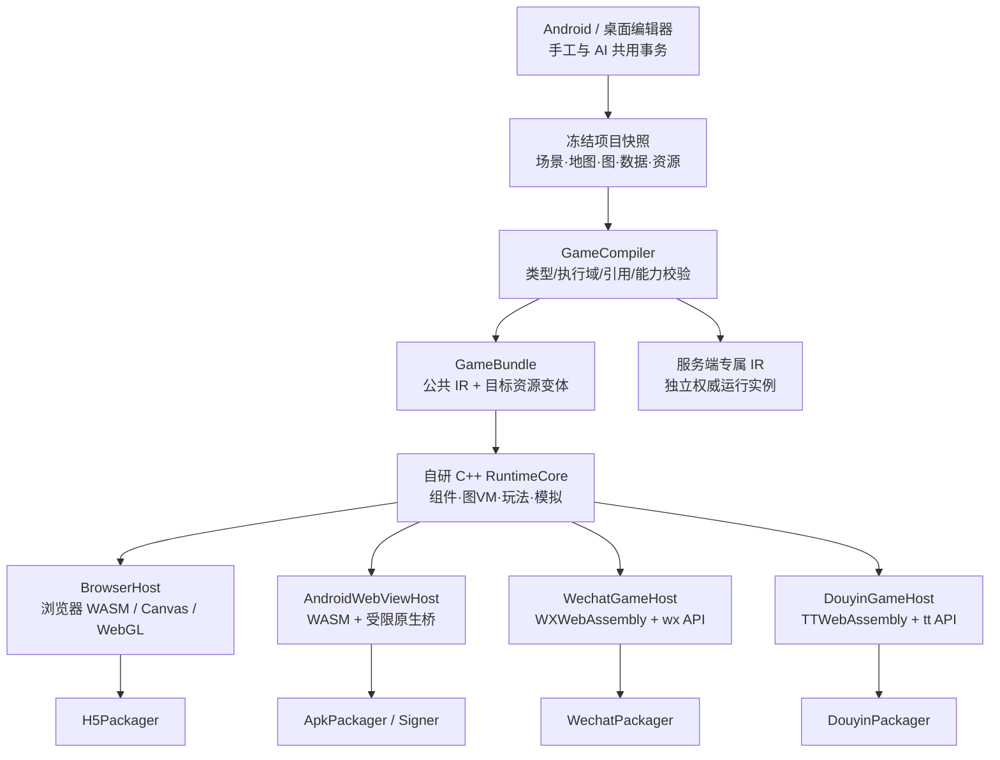

# 四目标运行与导出详细架构

版本：`arch-v3.6-draft.3`。日期：2026-11-14。关联：[总体架构](ARCHITECTURE.md)、[契约](CONTRACTS.md)、[功能覆盖表](FEATURE-COVERAGE.md)。这是待实测的设计与验收约定，没有声明四目标已实现。

执行策略：本轮仅文档；下述验证均为计划，execution_status=not_run、quality_verified=false、release_permitted=false。实际测试、扫描、截图比较或设备操作仅按用户真实会话的明确执行要求开展。

## 1. 已确认范围与完整性原则

用户确认的目标为 **H5、Android APK、微信小游戏、抖音小游戏**，后两者采用小游戏形态，不是普通小程序页面。Android APK 固定为 WebView + C++ 编译的 WASM。编辑器仍覆盖 Android 与 Windows/macOS/Linux；小游戏宿主的 Android/iOS 分别验证，不能以本项目没有 iOS 编辑器为由省略小游戏 iOS 宿主。

完整范围沿用 V3.5 的 F01—F21、24 个玩法家族和 V3.6 助手扩展。编辑器能力负责创作，游戏包携带必要的运行数据与运行能力；不会把 OpenCode、模型密钥、编辑器数据库、服务端图和积分后台一起打入游戏。“支持导出”必须证明玩法可以运行；生成几个配置文件只是其中一步。

Cocos engine **仅供架构思路、功能清单和公开行为参考**。项目不集成其引擎、源码、适配器、二进制、编辑器、导出模板、SDK 或构建服务；也不通过改名或薄封装引入。自行设计项目格式、组件、渲染、图 VM、宿主桥和打包器。获准复用的基础库另经版本、许可、费用、目标构建和维护成本审核。

四目标共同玩法能力必须齐备。某项尚未实现时登记缺口并阻塞其完整交付，不因目标能力检查报错就算完成，也不悄悄删去功能。平台专属登录、分享、广告、支付采用独立能力契约，差异有说明和显式选择；平台规则不允许的能力不能靠伪造等价实现承诺支持。

## 2. 一份游戏语义，四套宿主适配与打包

图中的核心为同源 C++，不是要求四目标的 WASM 文件逐字节相同。针对宿主可有工具链、导入表、资源和模块裁剪差异，玩法规则、节点语义与版本保持一致。JS/TS 仅实现受审宿主胶水、加载和平台 API 适配；禁止另外维护四套伤害、任务、经济、地图或 AI 生成的任意业务脚本。

编辑器原生试玩用于低延迟编辑；目标试玩调用相应导出运行器。原生试玩通过不代表 WASM 或小游戏通过。每次导出绑定同一个项目 revision，不能使用尚未保存的 UI 草稿替代冻结数据。

## 3. 核心分层、模块与链接边界

|层|职责|实现与约束|
|---|---|---|
|GameSchema / NodeCatalog|文档、类型、单位、节点、版本、能力声明|C++ 公共定义与生成的 Schema；编辑器和运行器共享语义|
|AuthoringCore|项目事务、地图编辑、图编辑、资源导入、诊断|仅存在于编辑器，不进入游戏运行包|
|GameCompiler|文档校验、图编译、引用闭包、客户端/服务端分包|输出版本化 IR、源映射、所需宿主能力与资源清单|
|RuntimeCore|实例、调度、图 VM、组件、地图导航、通用玩法模块|不直接依赖 DOM、Qt、JNI、wx、tt 或任意本地文件路径|
|RenderCore|摄像机、排序、批处理、文本/精灵/瓦片、特效命令|自有渲染语义；图形后端可替换，不以某个基础库定义玩法|
|HostBridge|画布、加载器、输入、音频、网络、存储、生命周期、平台服务|四个独立实现，共用契约测试；结果转成核心事件|
|BuildCoordinator / Packager|固定输入、变体选择、分包、身份、签名、校验|按目标生成工程/产物，不替代平台账号上传与审核|
|GameServerHost|房间/区域、可信时钟、权威图、持久化、交易|粗粒度独立进程；客户端包不含其实现或秘密|

组件模型优先使用稳定实体/组件 ID、组合与显式系统顺序。EnTT 等仅为内部候选，公开格式不能绑定其内存布局。节点编译生成 IR；普通项目导出不调用 C++ 编译器，也不接受动态 C++、JS 或 Lua 节点。新增内置节点须由研发发布对应核心与目录版本。

构建按功能闭包选择已构建的运行时模块/配置，不能逐帧跨 JS 边界执行每个组件。第一版优先少量可审查的预编译 RuntimeProfile；只有包体与测量证据支持时增加变体，不一开始引入复杂动态链接。未被引用的模块可裁剪，但隐藏的 Prefab、子图和合法动态引用必须进入引用闭包；不允许猜测性删除。

## 4. WASM 与图形公共基线

共同基线为标量 WASM、主线程调度和有界异步任务。SIMD、pthreads、SharedArrayBuffer、OffscreenCanvas、Worker 渲染和 WebGPU 均不是默认前提。宿主存在更强能力时可使用经验证的优化变体，保存格式、节点语义和正确性测试不变。

Emscripten 是 C++→WASM 工具链候选，版本与生成逻辑需审查；其官方[WASM构建说明](https://emscripten.org/docs/compiling/WebAssembly.html)将生成代码、WASM特性和部署要求分别说明。浏览器默认胶水不能直接当成小游戏适配器：加载 WASM 的方式、导入对象、画布与图形上下文必须能由宿主注入。优先显式导出稳定 ABI、显式导入 GameGen 宿主服务；依赖库若强依赖浏览器对象，应替换其后端或换库。

首个渲染实现采用自有 2D 命令与批处理，图形 API 后端验证 WebGL 1 可表达的基础路径及目标实际支持，再按测试启用 WebGL 2 扩展能力。bgfx 为可比较的后端候选，不是四目标已兼容的既定依赖。半透明、裁剪、遮罩、RenderTexture、粒子、骨骼、等距排序、屋顶淡出和字体都必须有跨目标样例。遇到扩展不足，提供经过画面与行为验收的基础路径；不能擅自丢效果或把复杂场景改成静态截图。

物理采用固定 tick，渲染按帧采样；物理、输入和帧率解耦。跨端浮点模拟不默认逐位确定，联网初期采用服务器权威、命令序号和快照校正。锁步或回滚如成为格斗等模板的具体需求，必须先补确定性与延迟证据，不以共用 C++ 声称已经具备。

## 5. 宿主接口与异步边界

|接口|公共行为|平台差异的处理|
|---|---|---|
|WasmLoader|按 runtimeHash 加载、校验 ABI/imports、返回实例|浏览器标准 WebAssembly；微信 WXWebAssembly；抖音 TTWebAssembly，返回形态由桥归一|
|Surface / Graphics|提供可用画布、尺寸、像素比、图形上下文与丢失事件|浏览器 Canvas、WebView Canvas、wx/tt 画布；核心不创建 DOM|
|Input / TextInput|ActionMap、坐标转换、触控取消、IME、焦点释放|键鼠/触摸/手柄按目标实测；安全区和旋转事件统一转换|
|AssetIO / PackageIO|异步读、内容哈希、取消、分包装载、缓存预算|网页资源、APK 内置资源、小游戏包内资源与平台下载缓存|
|Audio|分组、播放控制、混音能力、完成原因、单调播放时钟|浏览器解锁规则和宿主音频 API 由适配器处理；节奏模板单独校准|
|SaveStore|按 gameId/environment/user/slot 隔离的版本化存档|IndexedDB 等浏览器存储、APK 容器存储、平台文件/键值；原子语义由适配器补足并测试|
|Transport|HTTPS 请求、WSS 连接、取消、背压、认证和明确错误|不依赖浏览器 fetch/WebSocket 对象形态；wx/tt 请求与 Socket 归一|
|Lifecycle / Clock|启动、隐藏、显示、销毁、内存警告、单调/可信时间|后台策略与音频/网络恢复显式；不能在恢复时无限补帧|
|PlatformIdentity|可选登录凭据换取游戏会话|H5/自有账号、APK、微信、抖音分别适配；平台令牌只经受控流程交服务端|
|Social / Commerce|分享、榜单、广告、支付、恢复与幂等回调|按宿主、系统、账号资质和 API 版本独立声明能力，不与 GameGen AI 积分混用|

微信官方类型定义的instantiate返回Promise<Instance>，抖音文档描述的instantiate返回含module/instance的对象；宿主桥必须分别归一并以锁定版本实测，不能共用未经适配的解构代码。

WASM ABI 使用指针/长度、数值、代际句柄和明确所有权。JS 调用后不得保留可能失效的 WASM 内存视图；memory.grow 后重新获取视图。字符串用 UTF-8，64 位 ID 在 JS 消息中用十进制字符串，不能隐式转成不安全的 Number。

核心每帧批量接收输入/异步完成事件，批量输出渲染与音频命令。网络/资源/存档请求携带 requestId、ownerScope、generation、取消令牌；异步回调只入队，旧实例回调不得写新世界。JS/WASM 边界不做同步 HTTP、无限循环或逐实体高频往返。

StorageService 的“已保存”以持久化确认定义。若宿主没有所需事务能力，采用版本化数据块、校验和、双槽/日志与提交标记恢复，不能把一次内存写或异步提交请求当成完成。公开游戏设备上的秘密不能靠 WASM 混淆保护；服务端密钥保持在服务端。

## 6. 四个目标的运行与工程结构

|目标标识|运行方式|主要导出内容|必须单独验证|
|---|---|---|---|
|h5_browser|JS 宿主 + RuntimeCore WASM + Canvas/WebGL|index.html、启动器、WASM、GameBundle、资源/缓存清单、部署说明|资源路径、MIME/CORS、音频解锁、HTTPS、存储配额、刷新/缓存更新、桌面/移动浏览器|
|android_webview|Android 壳 + 受控本地资源来源 + WebView 内的 WASM 游戏|可安装 APK、壳身份/图标/Manifest、游戏包、签名与验证报告|断网启动、WebView 版本、返回/旋转/后台、进程被杀、桥权限、安装/同证书升级|
|wechat_minigame|独立启动器 + WXWebAssembly + 微信宿主桥|game.js、game.json、project.config.json、包内 WASM、资源、分包配置、许可说明|开发者工具及微信 Android/iOS 真机、加载返回值、图形/音频/文件/网络、基础库版本|
|douyin_minigame|独立启动器 + TTWebAssembly + 抖音宿主桥|game.js、game.json、project.config.json、包内 WASM、资源、分包配置、许可说明|开发者工具及抖音 Android/iOS 真机、包路径、图形/音频/文件/网络、基础库与宿主差异|

表内为本项目计划输出的布局，不代替平台完整配置规范。appId、方向、安全区、域名、分包、开放数据域与所用开放能力根据冻结的规则集生成。上传凭据不进入包；导出成功、上传成功、审核通过、上线分别记录状态。

APK参考Android官方[WebView本地内容加载](https://developer.android.com/develop/ui/views/layout/webapps/load-local-content)的WebViewAssetLoader路线，采用来源受控的本地资源加载路径，不开放任意网页调用原生桥。首版通用游戏无需原生协议桥；确需原生扩展时按包声明功能白名单、参数校验、来源约束与权限，逐项测试，不向游戏暴露整个编辑器服务。

## 7. 资源、分包、缓存与大地图

保留原始资源与 importSettings；编译产生按目标的纹理、音频、字体、图集、粒子和骨骼数据变体，统一以 assetId + 内容哈希寻址。尺寸、压缩和字体子集改变要能预览；有损优化不得未经确认改变角色、文本和玩法识别。资源许可进入 ThirdPartyNotices，与源素材来源绑定。

AssetPlanner 对场景、关卡、地图 chunk、预制体和子图生成依赖图，选择主包启动集、公共包和按需关卡包；避免关卡循环依赖导致重复下载或主包膨胀。Runtime 与启动必需代码优先随目标包交付；代码/WASM 的下载位置遵守目标规则，不把允许下载素材推断为允许任意远端执行代码。

TargetRuleset 单独版本化主包/分包/总包限制、允许扩展名、域名与工具要求。限制来自实际账号、平台文档和最终工具检查，本设计不把今天某个数字硬编码为永久事实。超限时显示各模块/资源贡献、可调整的分包或压缩方案，缺少必需内容时阻止发布，不能输出会在真机缺资源的“成功包”。

Runtime 使用可计量的 WASM heap、JS 对象、解码暂存、GPU 纹理、音频与缓存预算；包体大小不代表运行内存。地图按 chunk 装载并固定地图/拓扑版本，活跃引用阻止提前卸载；离开场景可释放不再引用的资源。分包失败可重试/返回，保留存档；下载半包不转成有效缓存。哈希校验和清单切换避免旧 IR 混用新资源。

首次运行、已缓存离线运行、缺包离线运行分别展示真实状态。H5 离线缓存属于明确环境能力；APK 本地游戏包可断网启动；小游戏受宿主缓存行为约束，不能对首次联网下载缺失内容承诺完全离线。

## 8. 联网、权威逻辑与平台功能

公共客户端网络基线为 HTTPS + WSS。HTTP、WebSocket、TCP/UDP、MQTT、Socket.IO、gRPC 等仍保留产品契约目录，但传输映射按目标区分。需网关的协议通过受控服务转换，说明顺序、流、断线、错误和认证差异；编辑器能测试 TCP 不代表四类游戏均能直连 TCP。

同一 API 契约编译成目标可用的网络节点，密钥通过会话或服务端代理取得，不把后台数据库口令/供应商密钥打包。服务器运行专属图、可信时间、伤害/交易/奖励权威；客户端隐藏信息在服务端过滤，不能仅在 UI 上隐藏。房间、持续世界、异步玩法共用消息版本、幂等键和存档迁移契约。

平台社交能力按 FeatureBinding 显式配置，例如微信分享、抖音分享、自有账号登录、激励视频和支付各有目标实现。缺少账号资质或平台限制时，项目选择合法替代/调整模式或保留阻塞；不向创作者展示“通用支付节点在所有目标直接可用”。GameGen 平台 AI 积分与玩家游戏内购买分别建账。

## 9. 本地构建与可回退流水线

流水线：保存并冻结 revision → 引用/类型/执行域校验 → 目标能力解析 → 依赖闭包与模块选择 → IR 编译 → 资源变体/分包 → 装配模板 → APK 签名或目标结构校验 → 完整性/许可检查 → 原子生成新产物。失败保留上一次成功包和错误定位，取消不留下伪成功状态。

编辑器安装相应免费构建组件后，本机生成 IR、资源和目标工程。预编译 WASM/Android 壳按核心版本分发，普通用户改关卡不需要安装整套 C++/Emscripten 工具链。引擎维护者编译 RuntimeProfile 的流程与创作者导出游戏的流程分开。新组件取得后需校验版本、哈希、许可和最低宿主范围。

Android 离线 APK 仍须完成资源打包、Manifest/图标/身份处理、DEX/资源装配、对齐、签名与验证的真机技术验证。桌面工具可用不证明 Android 本地工具链可用，云构建不能代替手机离线验收。小游戏本地工程生成不承诺 Android 能运行各家桌面开发者工具；上传方式依冻结的免费平台接口/工具确认。

BuildManifest 追加 coreAbiVersion、runtimeProfile、wasmFeatureSet、adapterHash、targetRulesetHash、minHostRequirements、resolvedCapabilities、moduleClosure、assetVariants、packagePlan、saveSchemaVersion、gameProtocolVersion 与 licenseSourceBundleRef。所有产物指向不可变源码版本；签名私钥与发布凭据保留在安全服务。

## 10. 从首个切片就验证四目标

|验收族|覆盖内容|完成标准|
|---|---|---|
|XT-01 语义|同输入图、数据、事件顺序、数值边界、随机种子、取消/预算|对照规定结果；浮点容差/不确定部分明示，不能用截图代替逻辑断言|
|XT-02 图形/交互|精灵/地图/UI/文本、遮挡、粒子、骨骼、触摸/键鼠、旋转/安全区|各目标实际画面与交互；差异记录关闭后才标兼容|
|XT-03 生命周期|音频解锁、切后台、焦点、断连、恢复、上下文丢失、内存压力|无卡键、重复奖励或无限补帧，存档按声明恢复|
|XT-04 资源/存档|首次/缓存启动、缺包、哈希损坏、配额满、迁移、断电/杀进程|完整版本恢复；半包不生效；错误可定位并恢复|
|XT-05 联网/权威|HTTPS/WSS、弱网、重连、重复命令、跨版本、网关语义|不重复交易/领奖，不泄露服务端图或秘密|
|XT-06 构建/发行|四类真实产物、手机离线 APK、安装升级、小游戏工程导入|输入快照可追溯；实际运行证据与最终 buildId/包哈希绑定|
|XT-07 完整玩法|24 家族代表模板及组合、各模块的异常与结算|每家族在四目标完成进入→操作→目标推进→结算→重试/继续→保存恢复|
|XT-08 成本/许可|免费必需组件、Cocos 禁止集成、GPL 例外、运行时源码与第三方声明|版本化依赖和权利清单；不以付费授权/私有构建服务作为通过前提|

M0即规划四宿主最小运行闭环，实际执行待用户明确要求；M2第一款游戏的验收范围同时包含四目标基础包。后续每增加一个游戏运行模块，同一增量补四目标样例，不能把全部小游戏适配拖到项目末尾。最终验收分母为约定适用的功能/模板 × 目标 × 宿主环境/状态；必需项未测、失败、未知都不能记为通过。平台专属项的适用性和排除原因逐条保留，便携玩法不得随意排除。

性能目标需先冻结设备、宿主版本、场景规模与预算，再记录冷启动、峰值内存、帧时间 p95/p99、音频时间误差、网络与加载数据。30/60fps 是产品目标，不是本次研究的测量结论。

## 11. 官方依据与适用边界

- 微信官方 [小游戏 API 类型库](https://github.com/wechat-miniprogram/minigame-api-typings) 及 [WASM 类型定义](https://github.com/wechat-miniprogram/minigame-api-typings/blob/master/types/wx/lib.wx.wasm.d.ts) 定义 WXWebAssembly、路径加载和返回接口。本设计据此为微信独立加载器留接口；类型定义不能证明特定设备兼容，正式依赖须固定 commit。
- 抖音官方 [小游戏开发指南](https://developer.open-douyin.com/docs/resource/zh-CN/mini-game/develop/guide/dev-guide/bytedance-mini-game) 描述 JS VM、tt API、无 DOM/BOM、Canvas、触控和目标工程。本设计因此不把浏览器对象作为通用核心依赖。
- 抖音官方 [性能优化与 TTWebAssembly](https://developer.open-douyin.com/docs/resource/zh-CN/mini-game/guide/minigame/optimization) 描述包内 WASM 路径及实例化接口，并列出宿主提案/线程限制。本设计采用无 SIMD/线程前提的公共路径，并要求独立装载和 Worker 验证。

查阅日期 2026-11-14。以上是架构依据，未运行各平台工具或真机。最低版本、包体规则和账号相关能力进入后续冻结的 TargetRuleset；官方文档变化触发兼容复验。
