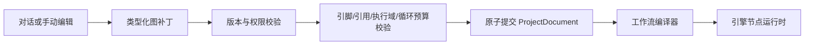

# 工作流与 OpenCode 接入约束 · V3.2

状态：技术设计约束，待研发验证。原型并未连接OpenCode、模型服务、数据库或游戏服务器。

## 唯一玩法来源

用户的新约束覆盖旧方案中“AI直接写脚本或代码”的选择。AI最终提交的玩法与服务端逻辑只能是工作流，包括节点、连线、类型化参数和资源引用。普通解释、规划文本可以存在于对话中；可运行的业务逻辑必须落到图中。配置表、关卡数据与图片音效是关联数据和资源。

AI与手动编辑共用ProjectDocument和GraphDocument，任何一方都不维护第二份脚本。图节点使用稳定ID、带方向和类型的端口及显式执行域。业务功能复用子工作流，而非JavaScript/Lua“任意代码”节点。新增基础能力由引擎研发实现为经过审核、版本化的节点；AI不能自行添加可执行节点实现。

建议的执行链为：

编译器可以产生节点字节码、内部IR和平台适配产物，这些由引擎确定性构建。生成的H5宿主包含研发提供的引擎代码，不改变“AI只产出工作流”的规则。不能仅把任意代码放进JSON或节点字符串就宣称符合约束。

## 对话与 OpenCode

参考OpenCode的项目会话、Plan/Build、对象附件、工具活动、权限请求、停止与重试、变更审阅。GameGen的审阅面板展示语义图差异，不以源代码diff作为普通用户的主要操作界面。

OpenCode内核和API必须在Android本机运行，作为App随包交付；不以远端Agent代替本机内核。桌面采用受管进程，Android先做嵌入Node运行时的移植验证：在App私有目录运行受约束的OpenCode核心，经本地IPC连接C++ AuthoringCore。OpenCode核心保留其原有实现，游戏引擎、文档、图校验与编译执行语义统一由C++实现；原生宿主和Agent运行时不必强行改写为C++。

本机内核离线可启动、读写和校验项目，不等于断网可请求云模型。模型调用按用户要求优先使用OpenCode官方免费模型；免费额度、可用性和分发资格必须验证，不能视为商业App永久保障。免费不可用或额度用完后，由本产品服务端的模型网关接入付费供应商，服务端保存供应商密钥并处理积分报价、授权、幂等扣费和退款；手机不持有供应商主密钥。免费通道不满足分发条件时，必须明确提示并转入本产品网关，不能悄悄绕过限制。此方案不要求手机本地推理大模型。

Android嵌入路径需要先冻结OpenCode提交和运行时版本，验证依赖在Android/arm64上的可执行性、Node/Bun专有API、原生扩展、SQLite、进程调用、沙箱、安装后启动与升级、前后台/进程被杀后的恢复、包体积和许可证。nodejs-mobile提供Android嵌入Node的路径，不能据此断言OpenCode已兼容。若移植验证失败，需修正适配层或评审阻塞项；当前不把“连接电脑或云Agent”当成已满足Android本机运行的交付。

适配层至少维护projectId、sessionId、messageId、runId、partId、graphId、baseRevision、requestId、eventCursor和执行域。消息、工具结果、业务追问、权限请求与执行状态分别建模；重连先对账已提交版本，再续收事件，不能把重试变成重复扣费或重复写图。

对外工具建议仅开放读取项目、检索节点目录、提出图补丁、校验、提交、预览等领域工具。图补丁必须验证完整结构和权限，提交需乐观锁与幂等键。OpenCode的shell、通用文件写入、任意执行和不受控工具不能绕过此入口；模型system prompt不足以强制这条约束。生成图片和音效是独立资源任务，完成后只把资源引用写入图。敏感工具授权与积分确认分开。

官方文档已切换V2；旧的server/SDK链接会转到V1文档。正式接入前必须冻结明确release/commit及协议，依据该版本生成客户端并做契约测试，不能混用V1的HTTP/SSE字段和V2事件语义。本原型只预留界面和领域语义，不把尚未验证的接口名称写死为集成承诺。

## V3.2原型中实际可操作的工作流

桌面可搜索节点、添加、拖动标题、点输出和输入连线，也可在属性栏用“连接到…”选择端口。手机竖屏使用节点库弹窗和属性抽屉；横屏将画布和属性并排，保留返回竖屏入口。选中连线可删除或插入动作；复制不复制连线；删除节点会移除关联边；撤销/重做恢复整个图事务。

客户端、API服务端、关卡/RPG/SLG模块各有独立图。图使用稳定ID、执行/数值/音频端口，拒绝类型不匹配、重复边、占用输入、自连接和回环。模块参数绑定包含关卡ID；服务端默认参数绑定指定接口，节点副本独立保存。对话任务在启动时绑定目标图及版本，之后切换页面不能把补丁写到另一张图。

当前原型每图最多80节点、一个事件入口、仅有向无环图；不提供任意代码节点。调试器解释有限节点及显式模拟输入，展示执行轨迹、分支和数值/音效数据边，不启动游戏引擎、数据库或网络请求。RPG/SLG条件目前使用模拟布尔输入，尚未实现完整任务、资源经济、地图或计时调度。未来循环、并发、子流程、异步任务和多入口调度必须有明确语义和预算，不能简单放开回环。

草稿保存在浏览器本机存储，刷新恢复图、API参数和模块参数；不保存模型凭据。损坏草稿保留原文并阻止覆盖。正式产品需替换为C++项目文档、原子磁盘保存、格式迁移及恢复机制；浏览器草稿不是跨端同步或永久备份方案。

## 共用核心与导出边界

C++ AuthoringCore统一项目文档、资源索引、图变更事务、校验、版本和编译；RuntimeCore统一2D节点执行语义。Qt和Android通过稳定C ABI/FFI或JNI调用同一核心。H5运行时优先验证C++经Emscripten编译为WASM，并用平台适配层处理渲染、输入、音频、存储和生命周期；微信/抖音小游戏另做宿主API及WASM限制验证，不能假设浏览器产物无需适配就可运行。

APK离线导出需要本地模板、已打包引擎、资源处理与签名组件；H5离线导出是静态运行包；微信/抖音导出为对应小游戏工程，上传审核依赖各平台工具和规则。本轮未构建这些工具链，没有生成真实APK/H5/小游戏成品。编辑器支持Windows/macOS/Linux；不增加iOS或桌面游戏导出。

## 关卡、RPG与SLG

类型在创建前由创作者多选，并能自定义组合。初始模板只提供模块组合和默认图，不限制以后改成另一类玩法。

| 类型或结构 | 编辑数据 | 工作流职责 |
| --- | --- | --- |
| 多关卡 | 关卡ID、入口、出口、依赖、进度、检查点 | 胜负判定、解锁、场景转换、存档 |
| RPG | 地图、角色、职业、技能、物品、装备、任务、对话、队伍 | NPC事件、任务状态机、战斗、奖励和剧情分支 |
| SLG | 方格/六边形地图、地形、阵营、单位、建筑、资源、科技 | 行军、寻路、生产、回合/时间推进、战斗结算和胜负 |
| 其他2D类型 | 规则、对象、资源与类型配置 | 用同一事件、条件、动作、数据和子图目录组合；能力缺口进入节点研发队列 |

引擎需要支持场景/预制对象、TileMap、碰撞、寻路、相机、动画、UI、音频、输入、状态机、数据表、保存迁移、调试与性能分析。SLG还需要地图分块、可见性/战争迷雾、大量实体更新预算、命令队列和可重复结算。此表是后续引擎范围，原型中的类型选项不证明引擎已具备这些能力。

## 联网 API 与服务端工作流

接口定义包含方法、路径、输入输出schema、认证与权限、错误码、版本、幂等、限流和超时。API入口直接绑定server域工作流。客户端只有类型化API调用节点，不能直接访问数据库、密钥或服务端图。客户端域和服务端域必须在编译期及运行期双重隔离。

标准服务端链：API入口 → 身份验证 → 资源归属 → 输入校验 → 业务判断 → 数据事务 → 响应；每一步均有失败分支。RPG领奖需要校验通关事实和防重复领取；SLG行军需要校验单位归属、位置、资源、并发版本和服务器时间。对战、经济与胜负以服务端权威状态为准，不能信任客户端提交的“已获胜”或最终资源值。

服务端可复用C++图解释器/编译器及节点语义，HTTP、持久化与作业调度由服务端宿主提供。高并发SLG还需独立评估长连接、分区/分片、定时推进、事件日志、重放与一致性；API图编辑入口不等同于已解决这些运行问题。

联网项目交付应包括游戏客户端包、API契约、服务端图、数据模型及部署配置。APK/H5/小游戏工程可在具备本地构建组件时离线导出；联网功能在服务器部署后才能运行。离线试玩可使用隔离模拟数据，不应把模拟响应当成真实服务。

## 参考与证据边界

查阅日期：2026-11-13。只采用官方文档或仓库，以下是参考来源，不是已完成集成的证据。

- [OpenCode官方项目与客户端入口](https://opencode.ai/docs/)：终端、桌面与Web客户端形态。
- [Agents](https://opencode.ai/docs/agents/)：Plan/Build及agent职责。
- [Permissions](https://opencode.ai/docs/permissions/)：工具动作、资源与allow/deny/ask规则；V1/V2字段差异。
- [MCP servers](https://opencode.ai/docs/mcp-servers/)：领域工具接入和MCP版本差异。
- [Attachments](https://opencode.ai/docs/attachments/)：对象引用适配需转换为该版本支持的输入；不能假设任意音频等二进制可直接进入模型。
- [V2 Session Contract](https://github.com/anomalyco/opencode/blob/dev/specs/v2/session.md)：会话输入、排队、执行和幂等的语义依据；dev文档本身不是冻结的集成版本。
- [Godot TileMap](https://docs.godotengine.org/en/stable/tutorials/2d/using_tilemaps.html)：地图图层、资源与碰撞/导航的职责参考。
- [RPG Maker MZ Database](https://rpgmakerofficial.com/product/MZ_help-en/01_08.html)、[Events](https://rpgmakerofficial.com/product/MZ_help-en/01_09.html)：地图、数据库、公共事件和战斗事件的编辑分工参考。

- [OpenCode核心源码](https://github.com/anomalyco/opencode/blob/dev/packages/core/package.json)、[构建入口](https://github.com/anomalyco/opencode/blob/dev/packages/core/script/build.ts)：冻结提交后检查运行时与依赖。
- [nodejs-mobile Android嵌入指南](https://nodejs-mobile.github.io/docs/guide/guide-android/getting-started/)：仅说明Node嵌入路径。
- [OpenCode免费模型](https://opencode.ai/docs/console/models/#free-models)、[Harness限制](https://opencode.ai/docs/console/harnesses/)、[Provider适配](https://opencode.ai/docs/providers/)：免费资格和通道需要逐版本验证。
