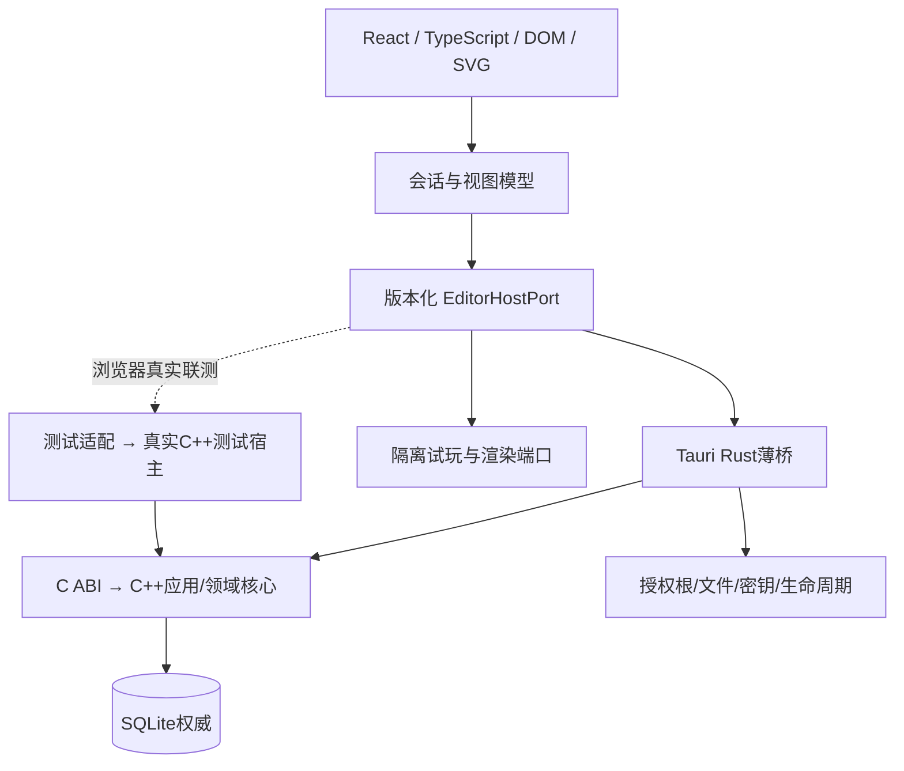

# GameGen 编辑器表现层与结构化自测架构

版本：`editor-web-v1-draft.1`；日期：2026-11-17。用户已确认本技术路线并要求写入架构；这不等同人员整版评审、实现完成或实际测试。execution_status=not_run，quality_verified=false，release_permitted=false。

## 1. 当前决定与替换关系

采用 **TypeScript + React 共用表现层、Tauri 2 薄宿主、既有C++20共享核心、结构化自测接口**。常规界面使用语义DOM，工作流节点/连线优先DOM + SVG，游戏视口保留Canvas/WebGL等引擎渲染方式。

本决定替换[总体架构V3.7第3节](../v3.7/ARCHITECTURE.md)“Qt桌面候选”和“Flutter移动候选”，及[旧共享核心文档](../v3.7/SHARED-CORE-AND-CLIENTS.md)中相应的表现层/桥接路线。旧文档保留为历史，不再据其新增Qt/Dart生产界面。替换理由和备选成本见[DECISIONS.md](DECISIONS.md)。

已有[本地M1交接](../../handoff/local-core-v1/CURRENT-HANDOFF.json)继续生效：C ABI1.0、消息1.0、DDL/schema1不变。根架构/流程清单继续属于无GUI核心包；本新增编辑器包单独维护[版本化清单](.architecture-mcp.json)，不把UI冒充M1已完成内容。

## 2. 产品与平台边界

Windows/Android为当前重点编辑器终端；macOS/Linux保留既有目标；iPhone/iPad/Android平板为未来编辑器适配。共用UI/核心语义，各端布局、手势、权限、后台和构建能力分别适配。

四个游戏目标仍是H5、WebView+C++编译WASM的APK、微信小游戏、抖音小游戏。Tauri只承载创作编辑器，不替换游戏APK容器，不进入四目标游戏运行包。Cocos engine仍仅参考，Reader/Writer和运行时/SDK/模板保持独立实现。

云端暂缓；静态前端随应用离线打包。本机测试宿主不等于云服务，也不要求产品常驻HTTP服务。GPL/独立游戏闭源商用方向和免费必要依赖约束保留，正式许可例外仍按原待办落实。

地图、动画、物理、数值、RPG/SLG、工作流、Agent、三Reader/LAN、未来三Writer等完整需求仍继承旧总体架构；本包不删除这些功能，也不声明已实现。

## 3. 模块与依赖图

|模块|职责|边界|
|---|---|---|
|editor-ui|页面/面板、键鼠触控、无障碍、响应式布局|不直写SQLite或复制事务校验|
|editor-session|焦点、选区、布局、草稿与UI恢复|缓存不是项目权威，不用旧revision覆盖新状态|
|editor-host-contract|类型化命令/查询/事件/任务/能力协商|不接受任意JS、SQL、shell或未授权路径|
|tauri-bridge|输入校验、权限映射、C ABI内存/任务适配|Rust不重写C++领域规则|
|authoring-core|共享应用/领域、事务、资源、历史/快照|不引用React、Tauri和平台UI类型|
|platform-host|系统文件授权、密钥、时钟/随机源、生命周期|前端声明不能授予真实权限|
|preview-host|独立试玩实例、输入/时钟、渲染诊断|不继承编辑器写项目能力|
|automation-adapter|语义定位、状态投影、任务等待、夹具/报告|不绕过真实应用服务，不伪造通过状态|

核心仍按平台产出DLL/SO/静态库；共用不意味着同一二进制跨系统加载。

## 4. 平台桥接

|终端|接入方式|必要系统适配|
|---|---|---|
|Windows|Tauri 2/WebView2，Rust FFI接现有C ABI|文件/重解析点、对话框、多窗口、IME/DPI、安装升级|
|Android|Tauri 2/System WebView；Rust FFI接C++库，必要系统能力用Kotlin/JNI插件|Activity重建、SAF授权、前后台、进程死亡、软键盘/触控|
|macOS/Linux|同一前端/Tauri及各自核心产物|WKWebView/WebKitGTK、文件权限、菜单、输入法与打包|
|未来iOS/iPadOS|共用前端/Tauri；C++静态库和Swift薄平台桥|安全区、触笔/键鼠、文件Provider、挂起、签名及执行限制|
|未来Android平板|同一核心/前端，工作区布局按终端适配|多窗口、横竖屏、键鼠/触控及预算|

Tauri引入Rust/插件工具链成本，不能称现有C++零适配可运行；Kotlin/Swift只承载系统端口。浏览器不能加载原生DLL，联测通过测试宿主或打包应用完成。

## 5. DOM界面与画布

项目/场景树、资源库、属性、任务、配置、弹窗和错误使用语义DOM。节点具稳定nodeId/portId，连线具稳定edgeId。虚拟列表保留按业务ID查询、滚动定位和键盘操作，不假设所有项同时在DOM。

游戏视口可继续Canvas/WebGL；同一Scene Model提供entityId、层级、变换、可见性、资源ready、命中和选区投影，与树和属性面板共用ID。原生GPU嵌入表面若后续采用，先补合成/遮挡、焦点、输入、生命周期和平台兼容性方案。

桥接传有界命令、增量投影、资源标识和分块数据，不逐帧JSON复制纹理/完整场景。渲染与编辑事务分离，预览实例不是编辑库写者。

## 6. 统一契约与一致性

详细见[INTERFACES.md](INTERFACES.md)。保留现有请求原字节、requestId幂等、expectedRevision、提案→校验→提交、异步终态及分配方释放规则。64位revision/计数保持十进制字符串，原生句柄不暴露为JS Number/指针。

前端草稿可以乐观显示，只有核心确认durable才显示已保存。取消请求不等于已取消；晚到成功仍按成功刷新。事件缺口、WebView重建或revision冲突时查询权威状态，不盲目重放写入。生产、浏览器真实联测和组件模拟使用同一HostPort，模拟只证明组件覆盖。

## 7. 不依赖识图的可测性

稳定testId采用“组件用途+业务ID”，不依赖坐标、数组下标、随机CSS类或本地化文本。正确role/label/name、焦点、禁用/忙碌/错误语义仍是基础。

|区域|结构化接口|能验证的事实|
|---|---|---|
|DOM组件|语义/稳定ID及状态|真实操作、校验和事件绑定|
|场景/资源树|ID、分页、选区、层级、ready状态|对象与关联、虚拟列表定位|
|工作流|节点/端口/边、诊断、编译/运行状态|连接约束和业务执行|
|画布|坐标变换、命中、渲染输入投影、包围盒|输入命中与模型更新，非像素正确性|
|预览|固定种子、可控时钟/步进、输入注入、状态摘要|可复现行为，非GPU/音视频效果|
|任务/保存|requestId/taskId、终态、durable revision、产物清单|完成/失败/取消和持久化结果|

投影来自实际应用/渲染输入，不能另造永远成功的测试状态。可变测试控制仅在明确的测试/诊断授权下启用；发布包禁用测试WebDriver、调试端口和夹具装载。结构化断言不替代文字裁切、布局、纹理、着色器、动画和设备输入验收。

## 8. 自测分层

1. C++基础层：持久测试宿主通过现有C ABI驱动同一库，输出结构化结果。
2. 组件层：React及模拟HostPort，只声明组件覆盖。
3. 浏览器层：Playwright操作同一生产前端，真实核心联测接本机真实宿主。
4. 成品宿主层：免费WebDriver/WebdriverIO验证Tauri窗口、IPC、核心库、权限/文件/生命周期；Android/iOS分别接平台驱动。
5. 游戏目标层：H5/APK/微信/抖音分别验证包、宿主API和实际运行，不由编辑器测试替代。

固化场景使用Playwright Test/CLI；探索可使用Playwright MCP无障碍树。详细系统策略/用例/安全与设备方案交独立quality，coding负责基础自测；本文不代写已执行结果。用户确认架构不自动授权运行测试。

## 9. 测试宿主与安全隔离

核心测试宿主为持久进程stdin/stdout JSON Lines，stdout协议与stderr日志分离。浏览器无法使用stdio时由测试启动器提供仅回环、随机端口/会话token的代理，限制origin、方法、授权根及输入上限；不监听LAN、不作为同步实现。

每场景使用隔离临时项目，不默认读用户现有项目/凭据；结束释放句柄、项目锁和进程。代理仅属测试发行物，外部网页/预览无连接权限。前端boolean不构成调试授权。

生产静态资源随包分发，不依赖Vite服务器、Node常驻进程或公网CDN。离线还需接收WebView/原生依赖和工具包，不能只因HTML打包便宣称完全离线。

按WebView/窗口分配最小Tauri capability；编辑器、预览、外链分别授权。外部导航无项目写能力，CSP、来源校验、资源scheme、输入限额、授权根共同限制跨界。凭据留本机代理/密钥库，不进DOM、项目、日志或游戏。

## 10. 扩展、负载、并发与预算

|维度|决定|方法与触发|
|---|---|---|
|可扩展|now|HostPort版本/能力协商；不兼容变化升版重交接，换宿主不改领域|
|可用性|now本机恢复；defer云高可用|沿M1提交/快照；WebView重建重查；任何已确认提交丢失停止对应放行|
|高负载|now有界；defer海量优化|分页/虚拟化/增量投影；超M1域另立扩容方案|
|高并发|now有界请求；defer多人同编|每项目单写者和背压，不增微服务/分布式事务|

不扩大M1的2MiB消息、1MiB分块/4在途、32任务、8MiB结果及原支持域。投影100项/页，事件单批最多256条且≤1MiB，原ABI若更严取更小值。前端最多16个未结束领域请求，满时等待/拒绝，不吞QUEUE_FULL；缺事件明确重查，不丢终态。

待验证目标：普通属性/面板交互p95≤100ms（不含外部I/O）；桥接受理p95≤50ms（不含核心执行）；固定60Hz场景主线程单帧p95≤16.7ms。环境/数据/WebView/样本由后续计划固定；移动分档另立明确预算，当前未测。

## 11. 迁移、任务与未完成工作

规划代码目录editor/web、editor/host-contract、hosts/tauri、hosts/platform、tools/core-test-host、tools/editor-test-driver，本次不创建实现或移动native/。现有HTML/JS原型提供交互参考，localStorage不作生产权威。

先做HostPort和最小界面真实核心闭环，再做场景/资源/属性，后续图/预览及系统端口。前端与桥接以兼容组合回退，数据迁移单独设计；不兼容组合拒绝打开写入。详见[DEVELOPMENT-HANDOFF.md](DEVELOPMENT-HANDOFF.md)。

主要框架具免费开源路径，见[DECISIONS.md](DECISIONS.md)；不采用必须付费的自动化provider。插件/传递依赖/SDK仍逐项核对。官方版本目录不是兼容锁文件，EW-T01接收并锁定Node/Rust/平台工具链和依赖，实施禁止浮动latest。

UI信息架构、页面/状态和交互稿仍由产品→UI阶段交接，技术选型不等于UI稿或整版审批完成；新包ready_for_coding=false。业务/UI问题回产品，开发技术问题回架构；真实评审和执行状态分别记录。本轮仅文档，未安装、编译、测试、扫描、截图/设备操作或发布。
