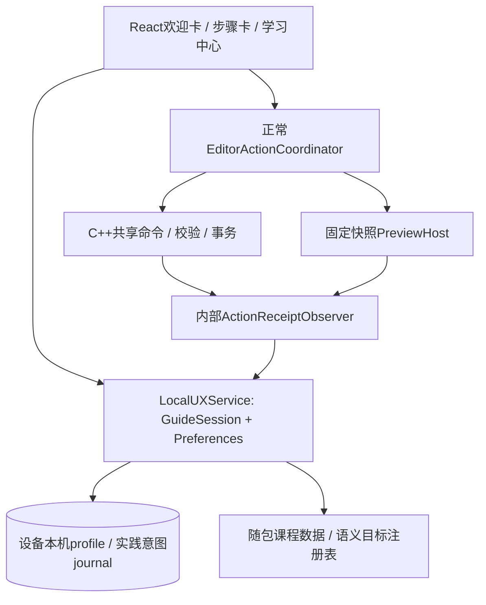

# 可跳过新手引导的实现架构

版本：editor-web-v1-draft.3；产品输入[ONBOARDING.md](inputs/product/onboarding/ONBOARDING.md)、[onboarding.json](inputs/product/onboarding/onboarding.json)，GUIDE-REQ-01—04/GUIDE-AC-01—12。以下是架构约束，尚未实现或运行。

## 1. 组件与唯一业务入口

Rust LocalUXService管理单一活动引导、课程/步骤记录和设备偏好；React呈现/定位，不拥有第二套游戏校验。课程为随包类型化数据，不能带eval、任意脚本、shell、收费请求或项目SQL。GuideSession只推荐正常动作/观察结果，不直接改工程；外观、图规则、保存、试玩、资源采用始终用原入口和同一权限。

## 2. 跳过与重新进入

首次欢迎给同级可见的开始/跳过；关闭和应用收到的Android返回与跳过一致。欢迎跳过只停止提示并记welcomeHandled，不能创建项目、导入资源、调用模型或扣费。当前视图可显示一次非阻断反馈，后台/下次启动不补弹。普通业务错误/权限/费用/危险操作说明不受教学提示总开关抑制。

每一步均可跳过或结束；界面先立刻停止遮罩、定位跟随和教学计时，再异步记录偏好。Core队列满、profile写失败或模型长任务不能困住用户。退出教程不取消、回滚、删除任何项目/草稿/资源/练习/已发任务，也不自动停止用户已启动的试玩。取消业务任务仍由其原任务入口处理。

学习中心始终可从项目首页/工作区帮助/SUR-GL-003进入；关闭全部自动提示不影响主动学习。重看只重置所选课程进度，不删除项目、不恢复模板、不清工作区布局。用户要求新练习时才另建副本。

Android系统键盘/系统权限及危险确认先由原拥有者处理；应用收到返回且当前只是引导层时结束引导并把焦点还给原工作区，不额外弹“是否退出教程”。正常导航不受教程阻拦；桌面Esc同理。

## 3. 单实例、版本与状态机

同一设备/OS用户只有一个LocalUXService profile actor和一个活动GuideRun。多窗口/旋转由可信工作区管理器转移显示权，不能双击开两个课程或重复建项目。服务重启换serviceInstanceId；profile/course revision与Core revision是不同命名空间。

课程状态沿产品：not_started / in_progress / skipped / ended / completed。
步骤状态沿产品：not_started / active / completed / acknowledged / skipped / blocked。
活动视图的suspended/目标不可见是运行态，不能抹掉已有学习结果。

- 首次dismiss→课程skipped，welcomeHandled=true；未实际逐步学过的步骤不伪造completed。
- start/resume由用户主动发起；start本身只打开步骤/练习选择，不发送Core写入。
- skipStep只作用于明确runId/stepId；结束步骤按真实完成、已了解、跳过分开记。
- end保留已有结果；必需实操G02/G03/G05/G06均有真实完成证据、G01为acknowledged且G04为acknowledged或completed时，才能标入门操作completed；G01/G04允许acknowledged，G04不强制真实付费调用。否则为ended并列出未完成部分。
- 已明确skipped/acknowledged或已结束的运行，不因迟到业务结果改写成“用户已完成学习”；实际任务结果仍在任务中心/项目状态显示。
- replay重置所选课程进度、换runId；旧运行的迟到证据不能推进新运行。已提交内容、自动提示开关和其他课程不隐式重置。

guideId固定guide.basics，本版guideVersion为onboarding-20261117-draft.1，stepId为G01—06。语言不是身份，翻译/排版变化不重置记录。课程语义更新保留旧版本和步骤映射；移除步骤留历史，新步骤只标新内容，不强制欢迎或重开。失效对象/项目引用显示选择/新练习/跳过，不自动重造。

## 4. 完成证据与能力

|步骤|可接受证据|缺能力或替代|
|---|---|---|
|G01|用户明确“明白了”，只记acknowledged|不要求Core或模型|
|G02|正常编辑入口的合法已应用修改及校验收据；也可为durable提交。必须匹配project/object/field与当前run|仅选当前Core已声明且确属外观的字段；若无支持字段或资源则blocked；颜色/材质无契约不假实现；原值已满足只记acknowledged|
|G03|类型化工作流实际提交且durable，绑定原request/transaction/revision|M1无editor.graph时blocked/讲解/跳过，不能塞extensions或自由脚本|
|G04|本地固定教学例子只acknowledged；用户主动真实调用且合法采用，才可completed|默认不调用模型，不配Key/MCP/Skill/积分；演示显著标“不是本轮AI结果”|
|G05|当前合法草稿按保存栅栏确认durable，且PreviewHost真正启动对应固定快照|没有Runtime/精确快照能力则blocked；明确选旧版不把当前草稿标保存|
|G06|实际停止隔离试玩并回到编辑工作区的正常事件|教程end本身不代替停止试玩或完成G06|

G02完成不等于保存；保存状态另取Core权威。ActionReceiptObserver只消费实际正常编辑/校验、Core、PreviewHost收据，带guideRunId/actionIntentId/project/object/sourceRevision等关联。不存在公用“把某步设completed”的UI命令。模拟适配器可以有合成示例，但必须标mock，不能证明真实任务完成。

完成记录是过去发生的学习事实，不是当前项目永远符合该条件的保证；后来撤销/删除对象不篡改历史，当前目标可用性另显示。重建时只核对已记录原意图/请求和收据，不因当前值恰好等于教程目标便伪造此前操作。

## 5. 本机profile与实践意图journal

profile位于宿主私有app-data下的editor-profile/onboarding-v1.json，和Core项目授权根分离。Rust通过版本化LocalPreferencesRepository读取/原子替换；优先复用现有同类模块，实际编码前仍按coding复用检查。Windows/Android共享存储与reducer源码，OS目录/原子替换由薄端口适配。

保存profileSchemaVersion、profileRevision、welcomeHandled、自动提示/显示进度/单功能抑制、课程版本/步骤状态、最近步骤及可选本机project/object引用。不存密钥、对话内容、完整工程、原生task句柄、绝对项目路径。引用不构成授权。

profile≤256KiB，最多32课程版本记录、512单功能抑制项；达到容量不能静默丢进度，返回具体错误，用户可按范围重置。profileRevision为u64字符串；宿主actor/CAS防多窗口覆盖。修改、内存可见、写入待定、persistedRevision分别表达；写失败保留当前内存并提示“进度未记住”，不把操作完成与偏好已保存混为一谈。

同目录临时文件→flush/sync→同卷原子替换（Windows端使用相应替换API），保留有界上一有效副本；路径和父目录由宿主固定，无任意文件写。校验/版本不认识则保留原件、只读/内存模式，不自动覆盖未来版本。原子替换不是已测的断电RPO承诺，设备存储行为仍待验证。写失败时当前进程抑制重复欢迎；跨重启保证依赖真正落盘，不能伪称失败也一定记住。

实践创建由正常ActionCoordinator执行。用户看到名称/位置/内置资源说明并选择独立练习后，先把稳定creationIntentId、Core请求原字节/ID和产物ID写入独立journal，再发Core。journal≤8MiB、最多1个未终结实践装载、128条有界元数据记录；资源字节留随包组件，以哈希/块引用恢复。超限或journal不可持久化时不发送新建副作用，可继续读/选已有项目/跳过。

重复开始复用同一意图；结果未知先按M1原创建/lookup恢复规则查实，不换ID重造。重启只恢复记录和提供主动继续，不自动重放项目写入。正式项目有草稿沿原离开/保存合同，不插示例覆盖。旧练习删除只让引用失效，不自动复制替代。profile、journal、课程关联不进入工程包、LAN、导出游戏或自动遥测。

## 6. 展示、定位与统计

GUIDE-VIEW-01—06是现有工作区的卡片/子视图/提示，不加六个主页。SemanticTargetRegistry以SUR-ID、字段/动作ID和对象ID定位；虚拟列表先滚动定位，目标不存在/被折叠/模态优先时回落步骤卡，不画悬空箭头。引导不吞点击/拖拽/滚动，不持续抢焦点。

中英日韩使用统一i18n key；项目名/用户原文不翻译，切语言/横竖屏保留run/步骤/草稿/任务。键盘/读屏可达跳过和结束，异步进度采用节制通知，不逐token播报。减少动态效果不影响操作。

只统计真实completed，与acknowledged/skipped/blocked分开；教程结束不等于全部实操完成。10分钟等为产品待验证目标，没有研究/样本结果。可在本机查看，默认不上传遥测。
