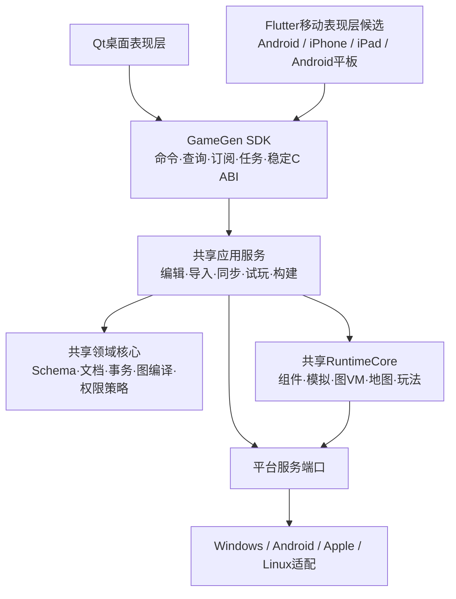

# 共享创作核心与多终端表现层

版本：`arch-v3.7-draft.1`；日期：2026-11-14。承接用户要求：Windows/Android 共用核心组件、客户端负责表现，App 为未来 iPhone、iPad、Android 平板保留扩展。本文为架构设计；execution_status=not_run、quality_verified=false、release_permitted=false。

## 1. 范围与架构决定

当前强制交付终端仍按产品交接为 Windows/Android，并保留既有 macOS/Linux 编辑器目标。iOS/iPadOS 和 Android 平板纳入架构扩展与适配规划；用户已确认这些是未来创作编辑器终端，游戏仍为原四目标；未来各端功能同等性、具体版本与排期需产品细化，不冒充已具备。编辑器平台与游戏发行目标是两个维度：编辑器可扩展到 iPad，不自动新增 IPA 游戏导出。

核心采用 **C++20 模块化组件 + 稳定 C ABI + 平台服务端口**。不仅共享 RuntimeCore，还共享编辑文档、事务、校验、命令、编译、资源、导入映射、同步合并、构建计划与任务状态。客户端不重写业务规则，不直接操作项目数据库。操作系统权限、文件选择、密钥、网络发现、图形表面和任务调度仍须有本机实现。

“共用”指同源实现、相同版本契约和数据语义；Windows DLL、Android SO、Apple 静态库/XCFramework、WASM 是按平台编译的不同产物。ABI 兼容范围、工具链、架构和依赖必须记录，不承诺一个二进制文件跨系统加载。

## 2. 依赖图与组件分工

|组件|跨端共用内容|平台差异/裁剪边界|
|---|---|---|
|DomainSchema|稳定ID、类型/单位、文档Schema、版本、来源/许可与localOnly标签|不引用Qt、Dart、JNI或Apple类型|
|Document/TransactionCore|项目唯一写入、提交/撤销、冲突、快照、迁移、恢复|SQLite/文件的打开与持久化设施可由宿主提供；事务语义不变|
|AuthoringApplication|选择对象后的领域操作、编辑命令、Prefab覆盖、地图/图/数值操作与诊断|像素布局、手势识别和面板折叠在UI；选区/图连接等领域结果经过核心命令|
|GraphCompiler/Runtime|五类图、客户端/服务端域、IR、模拟、组件、地图导航、玩法|渲染、音频、输入设备与网络实现通过端口替换|
|AssetPipeline|引用依赖、内容哈希、导入设置、变体计划、许可与资源预算|解码/编码器、GPU上传、文件授权依平台；不支持的工具返回能力诊断|
|InterchangeCore|导入中间模型、ID映射、转换报告、重导入三方比较、未来工程写出契约|三类源格式Reader当前只在Windows产品入口启用；其他终端只接收GameGen格式|
|SyncCore|设备信任模型、授权范围、协商、快照差异、分块账本、三方合并、幂等提交|发现、Socket/TLS、证书密钥保管与系统网络权限由宿主适配|
|Task/PolicyCore|取消/恢复、任务层级、有界队列、内容策略、凭据引用、权限与费用授权|后台可执行时长、前台服务、通知与进程生命周期由系统决定|
|BuildCoordinator|固定输入、能力解析、资源闭包、构建状态、产物与许可追踪|WASM/壳/打包组件按宿主能力安装；不是每个未来终端都默认能构建所有目标|
|AgentFacade|会话/事件、模型配置、工具权限、提案、上下文与localOnly出站策略|上游OpenCode宿主保留原实现；Android与未来Apple分别解决嵌入/运行限制|

平台业务后台与游戏权威服务器依旧采用既有独立模块/粗粒度进程，不因客户端数量增加拆成微服务。所有被分发的核心和客户端桥继续按既定GPL/运行时例外方案归属；第三方组件保留原许可。

## 3. 客户端技术路线与替代

本版建议把先前“Android Kotlin完整界面”改为 **Flutter移动表现层候选 + Kotlin/Swift薄平台桥 + C++核心**。Android先行，iOS/iPadOS使用相同移动端页面/状态与契约；平板按窗口与输入能力选布局。该变更尚无性能/可访问性/原生视口集成证据，状态proposed，不把框架支持列表当成产品兼容结论。

桌面仍保留Qt 6开源路径候选，面向复杂停靠面板、键鼠和原生视口。Qt与Flutter之间共享领域及应用服务，不强求同一控件树。Qt是否最终保留，在界面复杂度、团队能力和免费模块核对后形成ADR；当前没有原生生产界面实现需要迁移。

|路线|收益|成本/不采用为默认的原因|
|---|---|---|
|Qt桌面 + Flutter移动|保留桌面工作台能力，移动端共享Android/iOS/平板表现；C++业务核心统一|维护两套UI适配与一套SDK；需验证视口嵌入、输入/IME、可访问性和包体|
|Qt Quick覆盖桌面/移动|C++与QML集成直接，单UI技术栈|仍需移动交互/系统能力与开源模块核查；不能从桌面Widgets直接推断触控体验|
|Flutter覆盖所有客户端|最大化表现层复用，SDK边界统一|需评估复杂桌面多窗口/停靠、快捷键、大地图/节点编辑与原生渲染；不是本轮默认扩大重写|
|Kotlin Android + Swift Apple + Qt桌面|平台交互与系统集成直接|至少三套表现与状态适配，长期重复成本高；作为性能/集成障碍的有界替代|

Flutter官方[原生互操作](https://docs.flutter.dev/interop)说明C ABI/FFI和平台通道的不同边界。本设计据此采用核心命令/查询走C ABI，少量系统UI/权限走平台桥；不采用预览功能作为必需前提。框架代码/组件及工具链许可按冻结版本审查，必需能力不依赖商业插件或收费构建服务。

## 4. SDK契约与任务/线程

GameGen SDK分为CoreHandle、ProjectSession、CommandBus、QueryService、EventStream、TaskService和HostServices。契约首先定义版本化C头文件/Schema，生成或维护Qt/Dart/JNI/ObjC薄绑定；不得在绑定层增加第二份业务校验。

所有命令携带projectId、expectedRevision、requestId、权限/范围和结构化负载。查询返回不可变快照或分页数据；事件包含单调cursor、projectRevision、taskId与变更ID。UI用游标去重/补收；丢事件时重读快照，不能从文字进度推断事务已完成。

高频视口数据不通过JSON/平台通道逐实体传输；核心/渲染线程拥有场景和图形资源，UI只发输入与编辑命令。视口候选为宿主原生Surface/纹理与Flutter合成，不能每帧CPU读回整屏。纹理句柄、GPU上下文、尺寸、色彩空间、丢失/恢复均有明确所有者和寿命；具体嵌入方式尚待授权后的原型验证。

每个项目只有一个事务队列；渲染/模拟实例有自己的调度所有者；导入、哈希、编译与传输使用有界任务队列。UI线程只呈现结果，不能执行大文件解析或同步长FFI调用。取消沿任务树传播，异步完成携带实例generation；界面销毁只取消订阅或所属作用域，不能释放其他页面仍在使用的项目。

跨ABI不传STL对象、异常或Dart/Qt对象指针。缓冲区由分配方释放；错误采用结构化code/定位/恢复动作；回调通过受控事件队列转主线程。SDK支持GetAbiInfo、GetCapabilities、OpenProject、SubmitCommand、ReadSnapshot、Subscribe、CancelTask、CloseSession。未认识的必需能力明确拒绝，不能返回空成功。

## 5. 平台服务端口

|端口|Windows|Android/Android平板|未来iOS/iPadOS|
|---|---|---|---|
|FileAccess|用户选定路径与受控文件句柄|应用私有目录、系统文件选择授权|沙箱、文档选择/授权引用；不依赖PC绝对路径|
|SecureStore|系统凭据服务|Keystore保护本机密钥|Keychain等系统安全设施，密钥不随同步迁移|
|Discovery/Transport|指定私网接口的发现/接收服务、防火墙应用规则|NSD/系统选择器/权限；优先主动连接PC并复用双向通道|Bonjour/局域网权限；默认前台客户端，避免要求后台常驻服务|
|RenderSurface|原生视口与图形后端|Surface/纹理、输入焦点与音频焦点|Apple图形表面、音频会话、安全区/旋转；后端单独验证|
|Lifecycle/Tasks|窗口/进程退出、休眠/恢复|后台/前台任务、进程回收、通知与用户取消|可暂停/检查点任务，不把无限后台或外部子进程当作必需前提|
|DeviceInput|键鼠/手柄/IME|触摸/键鼠/手柄/IME、可选笔|触摸/键鼠/笔与IME按设备能力适配，不按平台名硬编码布局|
|AgentRuntimeHost|本机OpenCode宿主|保持用户确认的Android本机OpenCode要求|运行时嵌入、可执行代码/进程和分发要求未验证；不能直接搬用桌面daemon|
|BuildTools|按安装组件生成目标产物|维持离线APK目标，工具链仍有技术风险|先保留构建端口/能力模型；未确认所有离线构建均可在Apple设备进行|

Apple官方[局域网隐私说明](https://developer.apple.com/documentation/technotes/tn3179-understanding-local-network-privacy)要求按访问方式声明本地网络用途与Bonjour服务；[后台策略](https://developer.apple.com/documentation/backgroundtasks/choosing-background-strategies-for-your-app)说明后台任务有系统生命周期。Android[局域网权限文档](https://developer.android.com/privacy-and-security/local-network-permission)也按OS/target SDK区分授权。因此平台能力必须通过适配器协商，不能以框架跨平台为由省略权限或恢复。

未来Apple端最重要的未验证项是本机Agent宿主、可用工具/运行时、文件授权、后台任务和构建组件。当前Android的本机OpenCode约束保持不变；Apple可行性不足时记录阻塞并交产品/用户取舍，不静默改为云Agent。

## 6. 手机、平板与桌面交互

采用WindowProfile而非deviceName判断：可用宽高、像素比、安全区、键盘遮挡、输入能力、窗口/多任务状态决定布局。compact默认单主面板与抽屉；medium可左右双栏；expanded可多面板与停靠。具体断点由UI基于设计稿冻结，架构不擅自规定像素数。

布局改变只调整ViewState：选中对象、当前图/地图、面板、缩放和草稿仍绑定同一ProjectSession。旋转、分屏、键盘弹出、外接显示和输入切换不新建项目、不重置专业参数、不提交半次笔刷。触摸采用可发现的操作入口，键鼠增补快捷键/悬停；可选笔不成为编辑必需硬件。

UI负责控件、手势、焦点和可访问语义；核心负责保存/同步/计费/权限/冲突的真实状态。超过500ms的任务显示进度/取消；只有持久化或接收提交完成才显示成功。四语继续覆盖新增页面和错误，不翻译对象ID、代码参考、接口路径和用户自定义内容。

## 7. 组件制品与可扩展性

建议目录：core/domain、core/authoring、core/compiler、core/runtime、core/interchange、core/sync、core/policy；sdk/c-abi与bindings；platform/windows、android、apple、linux；clients/desktop-qt、mobile-flutter；exporters/runtime与project；tools/build-components。此为后续工程划分建议，当前不创建实现或空工程。

共用模块通过显式能力注册表组合，优先编译期/随版本分发；不为“扩展性”默认增加任意原生插件下载执行、脚本节点或跨进程微服务。新增模块必须声明依赖、许可、ABI/文档版本、执行域、任务预算、目标覆盖与迁移；宿主缺少依赖时定位并拒绝调用。

单端平台代码变化不更改项目格式；新增节点语义或格式变化则升级相应版本与迁移。新平台接入的完成条件是SDK契约、存储/恢复、视口/输入、权限、任务和完整功能矩阵的计划/实际证据分别具备，不以一个“Hello World”宣布完整编辑器支持。

## 8. 增量与未决事项

当前先形成SDK与移动路线ADR、平台能力矩阵和双端共享命令样例计划；再实施经正式交接的最小增量。用户本会话已确认编辑器终端方向；移动框架选择、目标最低版本、Apple功能同等性和本机Agent方案待评审，未来平台只保留接口与计划，不自动加入当前编码范围。基础自测文档由coding编写，系统性契约/集成/设备/恢复文档由独立quality细化；本轮全部not_run。

Apple编辑器还有独立的GPL/商店分发授权审阅项，详见[开源边界](OPEN-SOURCE-BOUNDARY.md)第10节。游戏运行时例外不自动覆盖编辑器分发；目前只预留平台端口，不承诺具体商店可发行。

## 9. 三种Profile独立组合

EditorHostProfile描述创作者所在系统/ABI、窗口与输入、文件/权限、Agent宿主和本机构建组件；GameRuntimeProfile描述四类游戏运行宿主的最低版本、WASM/图形/网络/存储能力；ProjectFormatProfile描述三类未来工程格式的精确版本、对象/逻辑映射和Reader/Writer能力。三者分别版本化，不能用一个platform枚举混合。

能力解析为“项目所需能力 ∩ 当前编辑宿主可用工具 ∩ 目标运行/工程格式能力”，输出可执行计划或具体缺口；项目完整功能需求不会因为交集缺失而删除。Windows可导入某源工程不意味着Android也出现导入入口，Android能本机生成APK不意味着未来iPad有相同打包工具，支持Godot工程格式也不代表新增Godot运行后端。

例如：WindowsHost + wechat_minigame生成微信运行工程；未来iPadHost + wechat_minigame仍需检查本机Packager/资源处理能力；WindowsHost + GodotProject生成可编辑工程，走ProjectWriter而不是微信Packager。组合能力表记录available/planned/unavailable/unknown与证据，unknown不得标为已支持。
