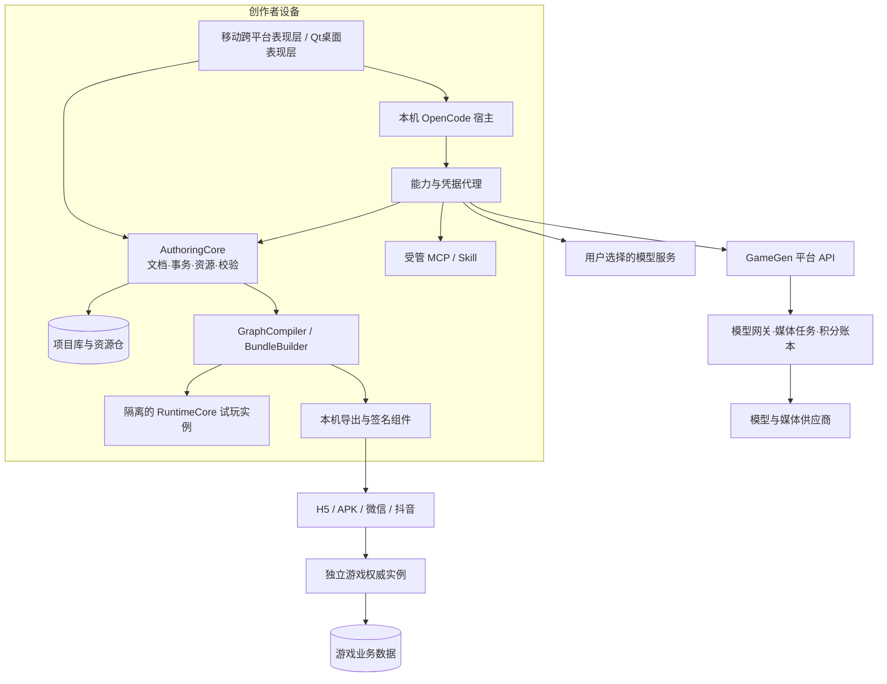

# GameGen 总体架构 V3.7

版本：`arch-v3.7-draft.2`。日期：2026-11-14。状态：架构建议，待人员评审和技术验证。本版产品输入为v3.8-core-editor-extension-draft.1，继承完整历史需求；在前版完整功能与四目标基础上，纳入三引擎导入、仅LAN同步、共享创作组件，以及未来三引擎工程写出/移动平板编辑器。输入文件与 SHA-256 见 [baseline.json](baseline.json)。需求编号及产品决定来自项目文件；本方案中的技术选型、阈值和开发顺序属于建议，并非运行或审批结果。

## 1. 架构目标与约束

面向没有游戏开发经验的创作者，优先完成“对话创建→手工修改→试玩→继续对话→导出”的闭环。完整范围仍包含专业地图、关卡、物理、动画、数值、RPG/SLG、服务端与多协议；实施顺序按依赖和风险组织。

必须保持的产品约束：

1. Android 与 Windows/macOS/Linux Qt 编辑器共用 C++ 项目语义。成品为 H5、APK、微信小游戏、抖音小游戏。
2. AI 与手工修改使用同一项目和事务。客户端与服务端的可执行业务逻辑都落为受限工作流；资源、地图、表格和契约使用类型化数据。
3. Android 本机运行 OpenCode 会话与工具调度；云端模型推理可联网。离线编辑、保存、试玩与组件齐备后的 APK 生成可用。
4. 自研引擎拥有项目格式、工作流语义和运行时。图像解码、密码学、物理等基础库可以经过许可证、安全与目标兼容性审查后集成。
5. 自带模型账户、OpenCode Go、平台免费额度和平台积分保持明确的费用归属。密钥不进入项目、提示上下文或游戏成品。
6. 新手界面逐步展开高级能力；视图切换不能重建或丢弃已自定义数据。
7. 客户端、核心与本地工具按 GPL 开源，官方商业平台使用独立私有实现；用户已确认独立游戏允许闭源商用，通过明确运行时例外落实，见第15节。
8. Cocos engine只作参考，不集成源码、适配器、运行时、编辑器、SDK、导出模板或构建服务；自研核心与四个宿主适配独立设计。完整功能责任见[覆盖表](FEATURE-COVERAGE.md)。
9. 必需框架、SDK、插件及构建/分发组件不强制购买商业授权，不收必付运行时版税。优先Apache-2.0、MIT、BSD；其他免费开源路径明确列出许可与义务。云服务、硬件与平台发行费用另列。用户现明确不用Qt需商业授权的部分，必需能力缺口自行开发并登记维护成本；详见[Qt约束](QT-OPEN-SOURCE-POLICY.md)。

10. Windows/Android共用完整创作核心与稳定SDK，客户端负责表现和系统适配；未来iPhone/iPad/Android平板是编辑器终端，不新增iOS游戏发行。
11. 当前新增Windows三引擎导入与Windows/Android仅LAN同步，内容localOnly；未来工程写出限定Cocos Creator/LayaAir/Godot，单独Writer，不改变四目标游戏运行路线。

详见[共享核心与客户端](SHARED-CORE-AND-CLIENTS.md)、[导入与局域网同步](IMPORT-AND-LOCAL-SYNC.md)、[可编辑工程导出扩展](PROJECT-EXPORT-EXTENSION.md)。

现状只有 HTML/JS 交互原型及文档，尚无原生生产核心。原型的 localStorage、有限解释器和模拟账单不作为生产实现基础；其中交互规则和测试样例可转化为正式验收案例。

## 2. 总体边界

采用客户端模块化核心、独立 Agent 宿主、平台业务模块化单体、按游戏隔离的权威运行实例。初期只部署确实需要的进程；模块边界先于分布式拆分。



平台账号、AI 服务与游戏运行账号分别建模。平台服务故障时，本地项目功能继续工作。某款游戏的 CPU、脚本预算、存储和发布不能影响另一款游戏或积分账本。

## 3. 建议技术路线与决定状态

|部分|本版建议|理由、成本与决定状态|
|---|---|---|
|共用核心|C++20、CMake、明确 C ABI；原生与 WASM 构建|延续产品的 C++ 约束；禁止跨 ABI 传 STL 对象/异常。编译器与工具链版本在验证阶段锁定。|
|Qt 桌面|Qt 6开源许可路径候选；优先 Qt Widgets 停靠面板与定制控件，视口独立渲染|按GPL/LGPL条款核查实际模块和完整构建/分发，不采购商业许可作为前提；验证视觉、缩放和可访问性。宽松许可UI替代候选为Flutter/Tauri，切换需评估视口、语言和开发成本。|
|移动编辑器|Flutter表现层候选，经C ABI/FFI接共享C++应用核心；Kotlin/Swift负责薄系统桥与原生视口|Android当前必做，未来iPhone/iPad/Android平板共享移动表现；替代前版完整Kotlin UI建议，状态proposed。包体/视口/IME/可访问性需后续证据，详见共享核心文档。|
|运行核心|自研组件模型、图 VM、2D 渲染与平台接口；C++ 编译为 native/WASM|可共享语义，不能据此承诺物理确定性或性能一致。渲染后端/物理/音频基础库在技术验证后选定。|
|OpenCode|保留上游实现，版本锁定；受管本机宿主加领域工具桥|不把 OpenCode 重写为 C++；上游 API、运行时和权限机制有版本差异。Android 可执行性仍为首要验证项。|
|本机项目库|SQLite 事务库 + 内容寻址资源仓|支持事务、恢复与索引；跨端交换用公开归档格式，不把运行中的数据库文件直接同步。|
|平台业务|建议 Go 模块化单体 + PostgreSQL + 对象存储|适合 API、异步供应商适配与账本协调；增加 Go 技术栈成本，属于待评审决定。若既有团队后端可复用，应比较接入成本后保留 API 契约、替换宿主实现。|
|游戏服务器|C++ 无界面 RuntimeCore + 房间/地图宿主；持久数据用 PostgreSQL|复用受限图语义；与平台业务采用进程和数据权限隔离。初期不要求自建分布式数据库、Kubernetes 或服务网格。|

这里没有选择 Go 前端；Go 的建议范围只有平台服务。依赖清单必须固定版本、许可证、哈希、漏洞处理方式及各目标构建证据；不以“最新版本”作为发布依赖。

具体候选、免费路径、接入边界与大型引擎参考见[复用候选清单](REUSE-CANDIDATES.md)。本轮仅核对官方许可与架构适用性，没有锁定或集成新增依赖。

## 4. 客户端组件与依赖方向

|组件|负责|禁止承担|
|---|---|---|
|Schema/Domain|ID、类型、单位、引用、版本、能力目录|平台 UI、网络请求、用户脚本执行|
|DocumentCore|项目、场景、地图、图、资源元数据、表格、接口契约|试玩状态、供应商凭据|
|TransactionCore|基线检查、原子变更、历史、撤销/重做、恢复|直接运行网络副作用或扣费|
|AuthoringServices|选择/工具语义、预制体覆盖、导入、影响分析、诊断|复制一套玩法数据给简易视图|
|GraphCompiler|图校验、域检查、IR、源映射、能力清单|接受任意代码字符串或隐藏网络操作|
|RuntimeCore|实例、固定步进、输入、任务、图 VM、组件系统、平台命令|编辑文档落盘、模型调用、发布凭据|
|PlatformServices|文件选择、渲染、音频、网络、存储、时钟、生命周期|改变图的业务语义|
|AgentBridge|上下文选择、受限工具、提案、会话映射、取消/续收|向 Agent 暴露完整工程写权限|
|InterchangeCore|三个版本化Reader、内部迁移模型、语义映射/重导入、未来三个Writer|运行源工程/复制Cocos实现，或把导入支持当成可逆导出|
|SyncCore/PolicyCore|LAN信任/授权、快照差异/续传/三方合并、localOnly出站策略|复制活数据库、按设备时间戳覆盖、走公网/ADB/云中继|
|BuildCoordinator|不可变快照、构建计划、包、签名调用、产物记录|把当前可变草稿混进正在生成的包|

依赖方向为宿主→应用服务→领域/契约。运行核心不链接 Qt、Android UI 或平台业务 SDK。对外 ABI 只有不透明句柄、版本化结构和序列化消息；内存由分配方释放，错误用明确返回值，异步结果带任务 ID。

每个打开的项目只有一个事务写入队列。UI 主线程仅处理交互与订阅结果；导入、编译、寻路重建、归档和构建使用有界后台队列。任务绑定项目与基线版本，取消和对象销毁都通过统一任务作用域传播。后台计算完成时如果基线改变，先校验相关依赖再采用结果。

## 5. 项目数据、持久化与交换

权威编辑数据存于项目 SQLite 库；图片、音频等不可变大资源存于内容寻址仓。缓存、缩略图、目标平台转码和编译产物都可重建。推荐内部目录：

```text
project/
  project.db              项目文档、事务、引用和版本
  assets/sha256/          原始及已正式接收的资源
  derived/                可清理的转码、缩略图和构建缓存
  recovery/               自动恢复点与锁定快照
  exports/                已完成的产物与发布记录
```

核心对象包含 Project、Scene、Prefab、Entity、Component、Asset、Map、Surface、Level、Graph、DataTable、Animation、InterfaceContract、SaveSchema 和 TargetProfile。稳定对象 ID 与资源内容哈希分开：替换资源内容不改变引用该资源的对象 ID，哈希用于校验与去重。

提交步骤为“完成资源写入及校验→落盘资源→数据库事务验证引用并提交→确认已保存→异步整理快照”。失败产生的无引用资源可稍后清理，引用未持久化资源的事务不能成功。数据库同步策略与磁盘/断电测试属于验收内容，不能仅靠文件改名推断已持久化。

完整事务进入恢复日志并在产品要求的最晚 2 秒内持久化；关闭、后台和导出先完成保存。只有持久化成功才能显示“已保存”。每 10 分钟及高影响操作生成恢复点，默认保留 20 个自动点，锁定点独立保留。磁盘不足时先保留当前完整事务与已有版本，停止继续写入并给出恢复路径。

交换格式建议为 `.ggproject` 归档，包含格式版本、JSON 文档、资源清单和资源内容，不包含凭据、运行数据库连接或本机绝对路径。导入先检查体积、路径、格式版本、引用与哈希，再写入新位置；禁止覆盖已打开项目。未识别的必需字段/节点导致兼容错误，不能静默删除。

当前新增Windows/Android显式LAN同步，双方保留本地副本，以共同快照祖先和领域三方比较合并；默认手动、单项目提交串行。设备离线可分别修改，重连不得按revision大小或时钟覆盖。经显式开启的授权范围内自动同步也遇冲突/删除/权限变化即暂停。CRDT和实时多人同编仍延后；不延后已确认的增量/续传/冲突能力。

## 6. 同源修改与工作流执行

所有修改使用 `PatchProposal → Validate → Commit`，AI 与画布调用同一入口。补丁包含 baseRevision、受影响对象、前置条件、幂等键和操作列表。客户端/服务器/编辑工具的执行域，在提交、编译和 VM 调用节点时分别检查。

提案通过结构和引用检查后生成语义差异；手工布局、注释、未知扩展字段和不相关参数必须保留。自动应用只针对用户明确设置的动作范围。基线冲突时重算、三方合并或保留双方，不能仅凭“AI 更晚生成”覆盖手改。

撤销是提交逆向事务；若后续事务依赖被撤销对象，应先做依赖检查或生成分支。外部请求、部署和媒体任务的取消/补偿各有状态，不能把本地撤销显示成已经撤回外部动作。

工作流采用多种前端语义和统一受限 IR：

- 事件动作图负责事件、分支、命令和异步任务。
- 计算图无副作用；类型包含单位、对象范围、空值和集合边界。
- 状态机/行为树、动画控制/混合图保留各自的状态与过渡规则。
- API 异步图显式表达超时、失败、取消、重试和幂等要求。

节点目录由研发签发版本，声明输入输出、执行域、副作用、权限、可取消性、最坏预算及各目标实现。AI 只能引用已安装节点。编译产物包含 IR 版本、节点目录版本、所需能力、资源依赖及源映射。运行时拒绝不兼容产物。

VM 每次事件有指令/时间/内存/任务数预算；循环有界，重入规则明确，异步挂起不会阻塞主线程。并行分支定义全部/任一完成、失败传播和剩余分支取消。对象销毁默认取消其所属任务；明确转为场景归属的效果可以继续。重播只重演可记录输入，不重复发送真实请求、发奖或扣费。

## 7. 引擎、地图与玩法模块

运行时使用场景实例、稳定实体句柄和组件系统；开始/停止/销毁有明确次序。只给热点系统引入批处理或数据导向存储，先通过实际样例定位瓶颈。编辑状态和每次试玩的实体/变量/存档沙箱独立。

渲染生成平台无关命令，平台后端处理图形上下文、纹理、混合、裁剪与提交。第一轮优先验证 2D sprite、瓦片、文本和基本粒子；桌面、Android、WASM 都要验证资源/着色器路线。物理、音频、骨骼库按目标兼容、许可、包体与可调试性选型；不能以一套 native 演示推断小游戏兼容。

地图空间分为逻辑坐标、通行面、碰撞/导航和视觉投影。等距投影只负责显示；高度、坡道、桥面与地面是可查询的拓扑。寻路状态至少包含位置、surfaceId 和移动能力；地面与桥面同格不等于连通。导航以 chunk 及其版本增量重建，旧任务结果不能覆盖新碰撞配置。

遮挡使用对象脚点、占地、高度区间和明确排序关系；屋顶/桥面支持部件化，选择命中可穿透到对象列表。地图、关卡、世界和地图实例分别建模，关卡可复用地图。客户端表现坐标和服务器权威移动必须使用同一地图规则版本。

平台跳跃、RPG、SLG 及其他类型由数据、节点与子工作流组合。类型模板不增加第二套 VM；战斗公式、任务进度、奖励、生产队列与科技前置都提供可测试的领域规则。局部随机生成记录 seed、算法/内容版本、锁定区和修改范围；生成结果也通过事务提交。

## 8. OpenCode、模型、MCP 与 Skill

本机 OpenCode 宿主由编辑器管理启动、健康检查、会话持久化和升级。优先通过锁定版本支持的嵌入 SDK 或本机 API 接入，统一映射为 GameGen 的 Session/Run/Event 契约。两种路径先做验证再锁定，不能混用 V1/V2 字段。官方 SDK 的嵌入能力不证明 Android 可执行性。[OpenCode SDK](https://opencode.ai/docs/build/sdk)、[V1 迁移说明](https://opencode.ai/docs/migrate-v1)。

安全边界由能力代理和进程/文件权限执行。OpenCode 使用隔离的会话目录，不拥有权威项目数据库、签名密钥或任意终端权限。内置文件写入、shell、插件加载和子 Agent 入口必须按实际版本逐项关闭或收窄；测试覆盖间接工具调用。提示词只补充行为约束。[OpenCode 工具权限](https://opencode.ai/docs/permissions)、[工具边界](https://opencode.ai/docs/tools)。

AgentBridge 开放项目查询、节点检索、补丁提案、校验、预览、资源候选等领域能力；提交仍经过 TransactionCore。上下文按用户选择与依赖裁剪，来源标识保留。每轮固定项目基线、模型配置、MCP 目录、Skill 哈希、权限和费用来源；中途改设置只作用于下一轮。

自带模型由本机模型代理直连用户地址，处理 Chat Completions、Responses、Messages 等格式的真实事件差异；品牌、消息格式与鉴权分别建模。平台模型走平台网关，供应商主 Key 留在服务器。模型适配与供应商路由只保留一个所有者：优先复用锁定 OpenCode 版本的 provider 能力，GameGen 补充策略与计费；不能让两层分别重试同一付费请求。

凭据层为调用提供短期授权或认证头注入，项目只保存 credentialRef。Android 用 Keystore 保护加密密钥并将密文放私有存储；Windows/macOS/Linux 使用系统凭据服务，Linux 无服务时只会话保存。Keystore 的密钥保护能力不能直接等同于完整的 API Key 生命周期实现。[Android Keystore](https://developer.android.com/privacy-and-security/keystore)。

MCP Broker 管理远程连接、本地受管进程、OAuth、目录缓存与动作权限。工具命名空间包含 serviceId；进程按可执行文件和参数数组启动，不交给 shell 拼接。Android 只允许应用已安装且兼容的运行时；桌面 MCP 不自动在手机可用。外部副作用记录独立 invocationId 和确认状态；超时先查状态，再决定是否重试。[OpenCode MCP](https://opencode.ai/docs/mcp-servers/)。

Skill 作为带版本和来源的资料包：先索引说明，匹配后加载正文与授权附件。导入检查目录逃逸、符号链接、体积、引用和可执行附件；启用 Skill 不等于运行脚本或扩大权限。更新保留手改版本，调用记录绑定实际内容哈希。[OpenCode Skills](https://opencode.ai/docs/skills/)。

## 9. 平台服务、媒体与积分

平台服务初期为一个模块化单体加独立后台 worker。模块包括身份/租户、模型目录与网关、预算授权、媒体任务、积分账本、资源交付及审计。PostgreSQL 保存业务状态，资源放对象存储；事务 outbox 驱动可重试作业。初期不需要独立消息中间件即可实现可靠出站任务；有积压证据后再引入。

积分账本使用整数最小单位、不可变流水和唯一业务键，记录 reserve/settle/release/refund。余额变更与任务状态在本地数据库事务中一致提交；供应商调用跨越事务边界，用稳定任务 ID、outbox、供应商幂等能力和对账完成恢复。端到端不宣称“恰好一次”。

模型流式任务在授权上限内计费，usage 缺失或响应中断进入待确认；不静默换付费账户。媒体按可用产物交付结算，下载/入库失败重取原产物，不重新收费生成。供应商不支持取消时保留后台任务并按产品规则交付/结算。取消请求、供应商确认、产物交付和退款分别有状态。

本地音效生成独立于聊天 Agent：模型包有版本、哈希、硬件需求和许可证，后台限资源执行；未安装时给导入文件或云端入口。AI 资源先进入收件箱，用户接收后作为正式资源事务入库。

## 10. 联网游戏与服务端工作流

单机、房间、异步策略、持续世界使用相同契约模型，但各有部署和一致性要求。首个真实联机闭环采用 HTTPS + WSS 小型权威房间。其他 TCP/UDP、Socket.IO、SSE、gRPC、MQTT 通过能力声明逐项接入；消息编码、安全层和传输协议分别建模。

一个房间/地图实例由一个逻辑执行所有者推进；客户端发送意图，服务器校验归属、速度、范围、冷却和资源。异步持久化结果回到该所有者队列，不从数据库线程直接改世界。游戏操作携带 session、sequence、commandId、worldVersion；重连先校验版本，再快照恢复和有限增量续传。

奖励、交易、库存、生产队列与可信时间属于服务器权威数据。数据库事务和唯一业务键防止重放领奖；客户端图不获得数据库节点或平台凭据。玩家内容、举报、封禁和运营权限由显式管理契约处理。

持续世界后续引入 zone、AOI、实例容量、迁移和所有权租约/围栏版本。跨区迁移先冻结归属、保存检查点、确认目标接管后释放源；失败按状态机恢复，防止双归属。这个流程必须先做故障注入验证，不能靠增加网关数量证明成立。

游戏数据按 gameId/environment 分隔，生产/测试凭据不同。发布客户端、部署图、迁移数据库和重置世界是四类独立动作。旧实例固定旧地图/图版本或按明确迁移计划切换；客户端不匹配时阻止进入。

## 11. 构建与四个目标

详细设计见[四目标运行与导出](FOUR-TARGET-ARCHITECTURE.md)。用户已确认微信小游戏/抖音小游戏形态，Q-003已解决；同一C++游戏语义配四个HostBridge与Packager。小游戏不依赖浏览器DOM/BOM，WASM加载器与wx/tt API独立适配。

统一流水线为“固定项目 revision→完整校验→资源依赖闭包→工作流 IR→目标能力检查→资源处理→打包→签名/校验→写完成记录”。BuildId 绑定项目快照、编译器、节点目录、模板、适配器、工具链及资源哈希。任何阶段失败保留旧成功包，临时目录不标为产物。

|目标|建议运行形态|必须独立验证的部分|
|---|---|---|
|H5|RuntimeCore WASM + JS 平台桥 + 静态资源|WebGL/音频解锁/存储/前后台/网络/缓存与首包大小|
|APK|用户已确认：预编译 WebView 壳 + 同版 C++ 编译的 WASM bundle|资源来源、安全 origin、最小桥、签名/升级、离线安装、不同 WebView 版本；与编辑器试玩做同图回归|
|微信小游戏|RuntimeCore WASM + 自研微信宿主适配（设计，未验证）|WASM、Canvas/图形、音频、网络、文件、分包和真机限制；未验证前无“支持”结论|
|抖音小游戏|RuntimeCore WASM + 自研抖音宿主适配（设计，未验证）|同上，按其实际基础库与开发者工具单独验收|

2026-11-14 用户在本架构会话明确确认沿用“WebView + C++ 编译的 WASM”。这项范围澄清记录为 Q-001 已解决，不代表对整套架构的基线审批。编辑器原生协议能力只有通过显式游戏桥才能进入容器，不能默认继承。原生 APK 游戏后端不进入当前开发范围，未来如需增加须评估目标能力、工具链与成本。

离线 APK 默认构建方案：随构建组件提供经过审查的壳 DEX/库、资源模板、manifest 模板和签名实现；每次编译游戏 IR/资源，生成本次身份/图标/权限，装配并签名 APK。日常项目导出不重新编译引擎 C++ 或任意用户代码；引擎升级通过新版本模板组件分发。

Android 本机的资源打包、ZIP 对齐、APK 签名及验证实现必须适配设备 ABI；桌面 SDK 二进制不能直接当手机工具。AAPT2 文档说明 compile/link 和 APK 组成，但没有证明其发行二进制能在 Android App 内执行。使用 zipalign 时先对齐再 apksigner 签名，签名后更改包会失效。[AAPT2](https://developer.android.com/tools/aapt2)、[apksigner](https://developer.android.com/tools/apksigner)、[zipalign](https://developer.android.com/tools/zipalign)。

签名 Key 由安全服务操作，构建目录只取得必要签名结果；导出备份由用户明确选择并加密。调试/正式身份分开，升级检查包名、版本号和证书。小游戏先输出目标工程/包，平台上传与审核单独记录。

## 12. 质量属性、威胁与恢复

以下是拟定目标和验证口径，全部尚未测量：

|属性|目标或必须保持的约束|验证证据|
|---|---|---|
|编辑响应|常用本地操作 100ms 内可见反馈；超过 500ms 有状态和取消|冻结设备/项目规模后测 p50/p95/p99 与输入到显示延迟|
|编辑持久化|完整事务最晚 2 秒落盘；不显示虚假保存成功|提交阶段进程终止、磁盘满、重启后逐 revision/引用核对|
|语义一致|相同图与输入在 native/WASM 给出一致的规定结果|跨目标 golden corpus；浮点比较策略和非确定节点单列|
|运行帧率|默认 30FPS，可选 60FPS|各目标基准场景的帧时间、内存、热降频及长时运行|
|计费与权限|未授权扣费为零；重复任务不重复结算|幂等、断流、超时、对账、越权和审计用例|
|构建|产物可追溯并反映冻结快照；失败不覆盖旧包|离线改地图/行为/素材后导出、安装、升级与内容哈希对照|
|服务恢复|首发建议账本已确认交易 RPO=0；灾难恢复 RPO/RTO 待业务与预算确定|同库事务一致性测试和实际备份恢复；不能把前者等同于异地灾备|

主要威胁与控制：

|威胁|架构控制及测试|
|---|---|
|文档/Skill/MCP 提示注入|来源视为数据，能力代理按权限裁决；越权读/写、隐藏工具和间接调用测试|
|工程/素材包路径逃逸、解析炸弹|沙箱解析、路径规范化、总量/深度/解压比限制、格式检查和恶意语料|
|密钥、签名、项目上下文泄露|凭据引用、日志脱敏、最小上下文、重定向剥离认证、导出扫描与进程边界|
|代理 SSRF 与租户越权|服务端独立出站策略、目的地址验证、对象归属检查和租户隔离测试|
|恶意图耗尽资源|编译与运行预算、服务器进程/配额隔离、超限终止与诊断|
|供应链/组件更新污染|固定哈希、组件签名、SBOM、回退版本及安装前完整性校验|
|离线项目/本机存储损坏|事务恢复、只读打开、另存恢复、备份与迁移回退；不自动覆盖损坏原件|

本地恢复从最后完整事务和恢复点开始，派生缓存可重建。Agent 恢复先对账已提交 transactionId 与外部 invocationId，再续收事件。构建恢复重新使用快照和工具链；无法证明中间产物完整时从安全阶段重建。平台 worker 通过 outbox/对账恢复。游戏服恢复使用已确认持久状态、检查点及明示的数据损失窗口。

## 13. 扩展性、可用性、负载与并发分别决策

|维度|现在实施|延后/不适用|证据、成本及可测触发条件|
|---|---|---|---|
|可扩展性|版本化Schema/节点、C ABI应用SDK、移动平台端口、Reader/Writer注册、provider/MCP、能力矩阵|开放任意二进制插件、通用第三方脚本市场|当前需求有四目标和多供应商；接口维护有成本。新增目标无法通过现有扩展点实现时评审接口，兼容 corpus 必须全部通过。|
|高可用|本地离线能力、服务重试/对账、数据库备份与恢复演练|跨地域双活、自动多主、所有服务多副本|尚无 SLA/预算/故障数据。业务明确恢复目标且单实例方案无法满足，或连续观测证明维护中断超出约定预算时扩展。多副本先解决会话、任务幂等和 leader 归属。|
|高负载|地图分块、资源裁剪、工作队列有界、缓存可回收、服务背压|无上限地图、无限实体、按想象预置 CDN/分库|用冻结样例测量。p95 延迟/帧时间/内存超预算并定位到容量瓶颈后，按剖析选择索引、缓存、批处理或扩容。|
|高并发|项目单写队列、房间单逻辑所有者、账本唯一键、连接/任务配额|万人同屏、跨区交易、分布式房间调度|并发目标尚未给出，不能声称容量。先测每实例安全上限并保留余量；目标超过该上限时增加实例，再以 AOI/分区而非单房间盲目扩容。|

通用消息总线、微服务、Redis、分布式锁、CRDT、全局强一致数据库没有自动成为首期依赖。引入任一项需要记录具体瓶颈、替代方案、运维成本和回退路径。

## 14. 运行责任与变更管理

角色均为待分配责任，未虚构人员批准：架构负责人维护接口/ADR和兼容性；核心负责人维护 Schema/事务/VM；客户端负责人维护 UI/生命周期/凭据；构建负责人维护模板/签名/四目标；平台负责人维护网关/账本/供应商对账；游戏服负责人维护权威状态和容量；测试负责人维护环境与证据；产品/设计负责人确认体验和范围。

统一关联 projectRevision、runId、transactionId、invocationId、taskId、buildId 和 gameInstanceId。日志默认脱敏，用户内容采集可控；监控关注事务失败、恢复、图预算、任务积压、供应商错误/成本、账本差异和房间 tick 超时。指标阈值在目标环境首次测量后冻结。

每个变更记录原因及对用户、范围、接口、数据迁移、测试、发布和成本的影响。核心决定、输入证据或验证结论变化后生成新架构版本及基线哈希。人员审批必须绑定具体版本和哈希；技术验证通过也不自动视为产品/设计批准。

正式开发交接依[DELIVERY-PLAN](DELIVERY-PLAN.md)的G1文档准备条件处理，当前没有工具返回的开发就绪结论。按用户最新流程，G0/测试/扫描/故障演练/设备操作均只编写计划，execution_status=not_run；实际执行须有用户真实会话明确要求。coding负责变更单元基础自测文档，独立quality负责系统性质量计划，UI准备最终构建验收矩阵；普通文档交付不要求原始扫描报告。文档就绪不表示quality_verified或release_permitted。

## 15. GPL开源与私有服务边界

按用户新增要求，[开源与闭源方案](OPEN-SOURCE-BOUNDARY.md) 纳入当前架构输入。公开核心保持完整本地创作和导出能力；私有平台网关、积分、媒体编排和运营采用独立业务API，不链接或复制GPL核心实现。开源划分不改变模块化单体部署原则。

建议主体GPL-3.0-only，运行时/导出模板增加经审阅的游戏发布例外，公共协议/轻量SDK建议MIT。具体GPL版本与接口目录许可是待批准的授权建议；用户已确认GPL方向及独立游戏闭源商用目标。第三方代码保留原许可，不能由本项目单方覆盖。

BuildManifest增加runtimeLicense、exceptionVersion、runtimeSourceRef、thirdPartyNotices和contentLicenseSummary。每个导出目标都必须能定位对应运行时源码；社区贡献进入例外覆盖文件前核对授权权利。用户项目内容与引擎代码的来源标记分开，不能把复制的引擎实现标成独立内容。

## 16. 本地隐私与多端增量的覆盖

localOnly策略对导入/同步内容及派生资源、报告、上下文、远程MCP、模型/媒体请求、云备份、遥测/错误附件在统一EgressPolicy处强制校验。旧版Agent自动上下文不能绕过；凭据只在设备安全库，配对不授予整盘访问。局域网核心复用事务和资源CAS，协议/发现/TLS由宿主适配；该能力不需要云服务。

未来工程写出从完整创作快照生成SemanticExportModel，再由独立版本化Writer生成目标可编辑工程；四目标Packager继续面向玩家运行。Cocos工程读写不集成其SDK/运行时/模板，外部目标工具由用户环境承担，缺少完整语义映射时必须报告，不能把运行包套壳当原生工程。

高可用仍以本机持久化/快照/恢复和断点为当前方案，常驻云协调/双活不引入。高负载在导入/哈希/传输采用流式与背压；高并发坚持单项目提交所有者和有界传输，初始预算见导入同步设计。触发扩展的依据为实际目标超过测得预算、需要新格式或新增终端；不因未来平台数量增加默认拆微服务。
