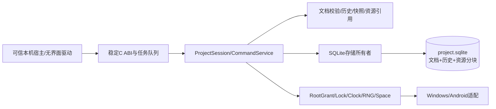

# 本地一期详细架构

版本：local-core-v1-draft.2；日期：2026-11-17。只设计M1共享核心，无产品实现或运行证据。本文与api/storage/transactions/platforms共同构成精确技术输入，优先于旧总架构中与本增量冲突的存储建议；完整产品范围继续继承。

## 需求与约束

本包LC-REQ-01—07、LC-AC-01—14由[需求拆分](requirements.md)定义；父REQ-017、REQ-040只覆盖当前子集。Windows/Android同源C++20，独立平台二进制；核心不引用Qt、Dart、JNI或Android SDK对象。Qt商业授权部分排除。没有云端、账号、发布或实时同编。当前无GUI，后续界面另交接，不借此删除完整产品UI。

## 架构形态与部署

模块化单体，一个宿主进程内链接一个核心库。Windows制品ggcore.dll；Android libggcore.so及薄JNI接入说明；同一C ABI/消息模型。M1每个CoreHandle只允许一个打开项目，库进程级维护规范路径与文件身份注册，跨进程再用平台独占锁。无数据库服务、worker服务、容器、微服务或后台常驻进程。

## 模块与依赖

|模块/建议目录|唯一职责|禁止依赖|
|---|---|---|
|core/schema|ID、版本、消息、Scene/ProjectSettings校验；未知字段策略|UI、OS路径、网络|
|core/document|文档差异、稳定ID寻址、引用索引与诊断|SQLite句柄、JNI、Qt|
|core/application|命令校验/提交、会话、幂等、Undo/Redo、SnapshotRestore|宿主控件、外部工具脚本|
|core/storage/sqlite|连接、DDL、事务、版本/快照/请求/资源数据、备份和GC|业务UI规则、网络|
|core/assets|SHA-256、分块、READY规则、来源/许可|素材云接口、任意文件路径|
|core/tasks|有界队列、取消临界点、结果租约、事件环|UI主线程调度|
|sdk/c|ABI验证、复制借用输入、句柄/缓冲区注册、错误封装|异常/STL对象穿过ABI|
|platform/windows、platform/android|授权根目录、独占锁、空间/时钟/RNG和私有目录约束|事务/权限规则的第二份实现|

接口方向：Host→SDK→Application→Domain/Storage/Ports。Storage只在每项目执行队列持有写连接；每Core一个执行线程，读查询也排队，杜绝读写连接看到不同head。资源大数据逐块短事务，不能把整个64MiB资源常驻多份。外部高级模块只注册Schema和命令，不直接持有sqlite3*。

## 前后端接口契约

本包只有宿主与本机核心边界，没有HTTP前后端。C ABI 1.0的句柄/任务/缓冲区定义见[头文件](spec/gg_core_v1.h)，JSON消息1.0与全部op/错误见[API](api.md)。所有I/O经任务，poll/read_events仅查内存。输入在函数返回前复制；输出必须由本库释放。事件seq只在当前Core实例有效，revision是项目内64位整数并以十进制字符串跨JSON传输。任务接收成功不等于持久化成功。

## 数据设计与迁移

[DDL](spec/project_v1.sql)给出v1表/约束/索引，[storage](storage.md)说明Schema、文档、资产、快照、GC与备份。WAL+synchronous=FULL；只在COMMIT成功后发project.committed。资产分块与其READY/引用在同一SQLite原子边界内，外部缓存丢失可重建。项目路径不写入业务文档；Windows路径和Android沙箱不可跨端固化。v1无历史格式迁移假实现：支持0→1新建，遇较新版本拒绝写；后续迁移必须在副本验证后替换，失败保留原件。

## UI技术路线与边界

当前包has_ui=false：没有Qt/Flutter依赖、页面或截图；无界面驱动是开发接入工具，不作为创作端最终体验。平台宿主不做自己的校验、Undo或数据库写入。未来Qt/Flutter经同一ABI接入，界面选型、手势、可访问性、图形表面与设计稿将在对应UI包冻结；这不阻塞纯核心接口的文档准备，也不声明完整客户端可开发就绪。

## 扩展能力与触发条件

|能力|当前决策|依据/替代与触发|
|---|---|---|
|可扩展性|now：ABI major/minor、消息/格式版本、Schema registry、BlobStore接口|首期不做动态插件。新增Schema需要版本/迁移；未知必需版本拒绝；替代是各端重复实现，因一致性成本排除|
|高可用|本地恢复now；云高可用defer|每次确认提交后RPO目标0；损坏留副本，支持快照/备份。没有云SLO需求，不引入副本共识；连续服务需求另立证据|
|高负载|有界内存/任务now；大项目后端defer|接受样本超过1GiB资产/500文档或一次授权测量超时延预算，评估外部BlobStore/索引；先测瓶颈，再改存储，不自动分布式|
|高并发|串行所有者/幂等/背压now；多人同编defer|同项目第二写者拒绝；队列32满即QUEUE_FULL。真实多写者需求出现后才评审合并/协调，不因多平台增加微服务|

设计验收预算（均未测）：基准Windows x64 SSD/4核/8GiB；Android API26+ arm64、4GiB、应用私有内部存储；fixture为100个≤16KiB文档、1,000实体、100MiB资产。普通≤16操作/64KiB提交p95≤200ms、固定fixture打开p95≤2s、取消受理后非提交任务≤1s结束、SDK无I/O入队/poll p95≤10ms。采样各100次，分开记录冷/热与设备型号；不把不同硬件合成一个数。超标由architecture/coding定位并调整实现/显式重评预算，不能伪造通过。数据量上限是首期支持域，完整产品容量另包扩展。

ADR-LC-01：资产权威字节同库，保留内容寻址接口；替代外部CAS方案在断电/目录持久化/两阶段恢复上增加一期成本。代价是库体积与备份放大；触发上限时迁移BlobStore，保留旧库只读，不改变assetId/hash。

ADR-LC-02：异步拉取任务/事件，不采用跨FFI业务回调。少一种调度/析构竞态，代价是宿主轮询；后续加通知只能唤醒宿主，不能改变所有权。

ADR-LC-03：Qt与Flutter本期不进入依赖闭包；先稳定核心ABI。图形选择另包，禁止以此将旧UI原型当正式原生实现。

## 安全威胁与控制

本机文件/JSON/数据库均不可信：限制体积/深度/类型，拒绝重复JSON键、非法UTF-8、NaN/Inf、路径穿越/符号链接/重解析点逃逸。SQLite禁用扩展加载、trusted_schema=OFF、参数化SQL，校验application_id/user_version及预期表结构，不运行库内自带脚本。错误不输出完整路径、正文、凭据。HostGrant只由可信宿主建立，本库不是隔离同一用户恶意本机代码的沙箱；未来Agent仍须OS/工具层文件隔离。默认localOnly，不提供网络/上传API。

## 运维与恢复职责

本包没有线上值班服务。coding实现恢复/备份，architecture维护格式/预算，独立quality维护恢复计划；具体人员在领取任务时登记。崩溃重开使用SQLite原生WAL恢复，不手删WAL/SHM。quick_check/foreign_key_check失败则停写、留原件和脱敏报告，可选只读；备份通过SQLite backup API，禁止复制活跃的单个db文件。恢复目标为已确认提交RPO=0、基准fixture打开≤2s；损坏项目修复RTO不作无证据承诺。诊断仅本地，有界1000条/1MiB轮转，不含正文；维护补丁与依赖按锁定版本记录，无商业Qt支持前提。

## 敏捷增量与回退

WIP=1主要实现/人，最多2个待集成变更；任务LC-T01—08详见[work-items](work-items.md)，先SDK/项目库，再命令/历史，再资源/快照/恢复，最后双宿主对接。每项明确产物/契约/正常与失败验收/回退，未通过的领域不要叠加完整编辑器。当前只是设计交付，不启动实施或实际验证。

## 验证方案与风险

coding只编写单元/主路径/失败路径基础自测；独立quality的八类计划见quality/strategy.md与cases.json，所有not_run。没有构建就不填写build_id。正式工具检查/接收基线和真实审批另存；用户要求补充不等于已批准所有技术决定。

残余风险：依赖组合与Android 16KiB页兼容尚未构建；SQLite资源体积/备份成本待测；未来图/地图Schema、Reader/LAN/四目标宿主/Apple能力没有本包实现。它们分别阻塞对应后续包，不能据此宣称本产品完整开发就绪。本包接口或DDL若需改动，先更新本包版本、源文件/清单摘要和影响说明，再交下游；不得只在代码里漂移。
